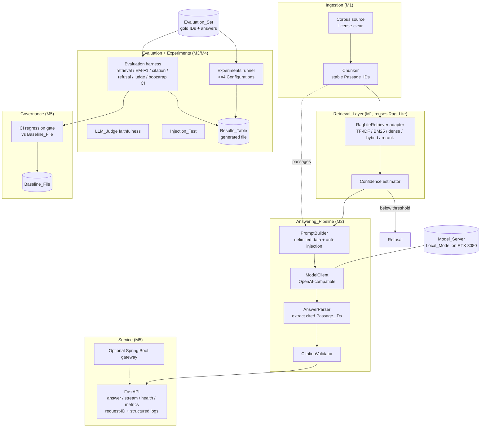
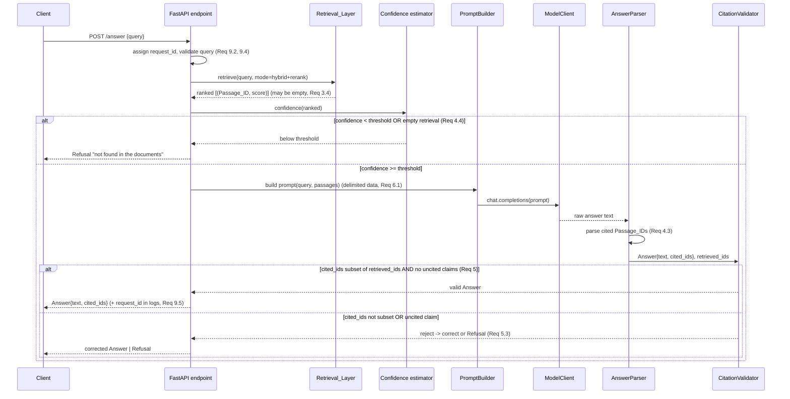

# Design Document

## Overview

The Grounded QA Service answers natural-language questions **only** from a license-clear document collection (the Corpus). Given a query, the System retrieves candidate Passages using the reused `rag-lite-tfidf-eval` library (Rag_Lite), reranks them, builds a prompt that delimits the retrieved Passage text as untrusted data, asks a Local_Model served through an OpenAI-compatible endpoint to answer using only those Passages and to cite each Passage_ID it used, validates that every cited Passage_ID was actually retrieved, and either returns the grounded Answer or a Refusal (`"not found in the documents"`) when retrieval confidence is below a configured threshold. Everything the System reports is a Measured_Value produced by a repository script and recorded with its generating command, seed, and full 40-character commit hash (Req 0.1).

### Problem

Ungrounded LLMs hallucinate and cannot be verified. For a portfolio project that must be defensible in an interview, every answer must be traceable to a source Passage, every claimed metric must be reproducible, and every dependency must be proven on the target machine and license-checked (portfolio-rules.md, Req 0).

### Solution shape

A thin, testable pipeline wraps a reused retrieval library and a locally served open-weight model:

```
query -> Retrieval_Layer (hybrid + rerank, via Rag_Lite) -> confidence check
      -> [below threshold] Refusal
      -> [above threshold] PromptBuilder (delimited data block + anti-injection system prompt)
      -> ModelClient (OpenAI-compatible) -> AnswerParser (extract cited Passage_IDs)
      -> CitationValidator (every cited ID in retrieved set, no uncited claims)
      -> Answer | corrected Answer | Refusal
```

Around that pipeline sit an evaluation harness (retrieval metrics, answer EM/F1, citation precision/recall, refusal accuracy, LLM_Judge faithfulness validated against owner labels with Cohen's kappa, 95% bootstrap CIs), an experiments runner that generates the Results_Table across at least four Configurations, an Injection_Test, a FastAPI service with streaming/request-IDs/structured logs/metrics, Docker Compose orchestration, and a CI regression gate.

### Milestone mapping (summary)

The work is delivered in milestones M0–M5, each ending in an automated milestone gate (portfolio-rules.md: unattended run). A full table appears in the final **Milestone Mapping** section.

| Milestone | Delivers |
| --- | --- |
| M0 | Proven environment + Model_Server smoke test (Req 1) |
| M1 | Corpus, Evaluation_Set, reproduced retrieval baseline (Req 2, 3) |
| M2 | Answering_Pipeline + Citation_Validation + Refusal (Req 4, 5) |
| M3 | Evaluation harness incl. LLM_Judge vs owner labels (Req 7) |
| M4 | Configuration experiments + Results_Table + Injection_Test (Req 6, 8) |
| M5 | FastAPI service, Docker Compose, CI gate, README (Req 9, 10, 11) |

## Architecture

### Component diagram



### Query sequence (answered path and refusal path)



### Data and control flow notes

- The Retrieval_Layer never raises on a no-match query; it returns an empty ranked list (Req 3.4), which the confidence estimator maps to a Refusal (Req 4.4).
- Retrieved Passage text flows into the prompt strictly as a delimited data block; no retrieved text is ever concatenated into the instruction region (Req 6.1).
- The only values the Answer may cite are the Passage_IDs present in the prompt, and `CitationValidator` enforces the subset relationship against the retrieved set (Req 4.3, 5.1, 5.2).
- The evaluation harness, experiments runner, Injection_Test, and CI gate all consume the same pipeline and the same Evaluation_Set so numbers are consistent and reproducible.

## Technology Choices and Rationale

Concrete library and model names, versions, and licenses are **proven at M0 and recorded in `docs/ENVIRONMENT.md`** with a verifiable artifact (Req 0.5, 0.6, 1.5) and in `THIRD_PARTY.md` (Req 0.7). This section commits to the shape of the choices and the selection criteria; it does **not** record a proven version and contains **no benchmark numbers** (those are Measured_Values produced at M0–M4).

### Language, framework, tooling

- **Python 3.11+** — matches the Rag_Lite stack and is verified in the smoke test (Req 1.8). Pinned exact versions for every dependency (Req 0.10).
- **FastAPI + Uvicorn** — async, native streaming (`StreamingResponse` / SSE) for Req 9.3, Pydantic validation for Req 9.2, and simple middleware for request-ID + structured logging (Req 9.4, 9.5).
- **Docker + Docker Compose** — a single documented `docker compose up` starts the service plus every dependency (Req 9.7, 11.3); Docker availability is checked in the smoke test (Req 1.8).
- **GitHub Actions** — the CI_Pipeline runs on pushes to the default branch and PRs targeting it (Req 10.1); `.github/workflows/` already exists.
- **pytest + Hypothesis** — unit tests (>=80% statement coverage per non-trivial module, Req 0.11) and property-based tests for the correctness properties.
- **NumPy / SciPy** — bootstrap resampling and Cohen's kappa (Req 7.5, 7.6). (`scikit-learn` may supply `cohen_kappa_score`; chosen library is recorded at M3.)

### Local model server (fits ~10 GB RTX 3080)

The Model_Server must expose an OpenAI-compatible `/v1/chat/completions` endpoint so `ModelClient` is server-agnostic. Candidate servers, selected and proven at M0:

- **Ollama** — simplest OpenAI-compatible local server, GGUF quantized models, good VRAM fit control; strong default recommendation for a single-GPU workstation.
- **llama.cpp server (`llama-server`)** — OpenAI-compatible, fine-grained GGUF quantization and GPU-layer offload control to stay under 10 GB.
- **vLLM** — highest throughput and best streaming, but AWQ/GPTQ 4-bit quantization is required to fit a 7–8B model in 10 GB; more operational overhead.

**Decision (autonomous run):** **Ollama** `ollama/ollama:0.40.6`, run in Docker inside WSL2 on the RTX 3080 (Compose project `gqa`, `OLLAMA_CONTEXT_LENGTH=8192` because the 4,096-token default can truncate a five-passage prompt, `OLLAMA_MAX_LOADED_MODELS=1`). `ModelClient` stays strictly OpenAI-compatible so another server can be swapped in without pipeline changes.

**Decision: open-weight instruction models** (digests, quantization and licenses proven and recorded at M0):

- **"smaller" end:** IBM **Granite 3.3 2B Instruct** (`granite3.3:2b`, Q4_K_M, Apache-2.0).
- **"larger" end:** IBM **Granite 3.3 8B Instruct** (`granite3.3:8b`, Q4_K_M, Apache-2.0). It is also the LLM_Judge.

**Decision: corpus and questions:** the **SQuAD 2.0 dev set** (CC BY-SA 4.0). Each context paragraph is a document; questions with an answer span supply gold Passage_IDs (the chunks containing the answer offset), and SQuAD's unanswerable questions supply Unanswerable_Questions. A reported Evaluation_Set (200 questions) and a disjoint tuning split (100 questions) are sampled with a fixed seed; refusal thresholds are tuned only on the tuning split.

**Decision: dense embedder and cross-encoder run on the CPU** (CPU-only PyTorch), so Rag_Lite never competes with the Model_Server for the 10 GB of VRAM and the same lockfile works on GitHub-hosted runners. Their Hugging Face revisions are pinned.

The selected Local_Model's measured peak GPU memory during the smoke test must not exceed `nvidia-smi` total GPU memory (Req 1.3, 1.4). Model license (open-weight) is recorded in `THIRD_PARTY.md` and `docs/ENVIRONMENT.md` (Req 0.7, 1.5).

### Optional hosted model

A Hosted_Model may back one Configuration under an owner-set **Spend_Cap** (USD/month) recorded in `docs/ENVIRONMENT.md` (Req 1.7); its API key is read only from an environment variable (Req 0.9, 9.8) and its per-token prices drive the cost column (Req 8.5). This is optional and off by default.

### Rag_Lite reuse: pinned package vs vendored modules

Two options satisfy the requirements:

1. **Pinned-version package install** — add `rag-lite-tfidf-eval==<exact>` to pinned dependencies; record the exact pinned version in `THIRD_PARTY.md` (Req 3.5, 0.10).
2. **Vendored named modules with attribution** — copy specific Rag_Lite modules into the repo, attribute each copied module to Rag_Lite, and record Rag_Lite's license in `THIRD_PARTY.md` (Req 3.5, 3.6).

**Decision:** Rag_Lite is installed as a pinned Git package at commit `035f182ebf71ab46db12a832917e0a02d8963cb0` (package `rag-lite` 0.1.0, MIT, importable as `src`). Facts read from its code at that commit: `retrieve_hybrid` always returns the top `k` results even when every score is zero, so the adapter applies a lexical scoring floor (drop results sharing no word with the query); BM25 scores are divided by the per-query maximum, so BM25-only confidence is nearly always 1.0 (known limitation).

**Original recommendation:** prefer the **pinned-version package install** when Rag_Lite is installable and license-compatible — it keeps provenance crisp (one pinned version string), avoids drift, and makes the reuse unambiguous for Req 3.1/3.5. Fall back to **vendoring named modules with attribution** only if the package is not installable on the target machine; in that case each copied module is listed by name in `THIRD_PARTY.md` (Req 3.6). Either way, the Retrieval_Layer is a thin adapter and does **not** reimplement TF-IDF, BM25, dense embeddings, hybrid fusion, or reranking (Req 3.1).

## Components and Interfaces

All interface sketches are Python 3.11 with type hints and dataclasses/Pydantic. Signatures are illustrative of responsibilities and boundaries; exact bodies are implemented in M1–M5.

### Corpus ingestion & chunking (M1)

Responsibility: load the license-clear Corpus and chunk it into Passages, each with a **stable, deterministic** Passage_ID that is identical across repeated runs on the same Corpus (Req 2.2); detect and report duplicate IDs (Req 2.2).

```python
@dataclass(frozen=True)
class Passage:
    passage_id: str          # stable, unique, deterministic
    doc_id: str              # source document identifier
    chunk_index: int         # position within the document
    text: str

class Chunker:
    def __init__(self, max_tokens: int, overlap: int, seed: int) -> None: ...
    def chunk(self, documents: Iterable["Document"]) -> list[Passage]: ...

def passage_id_for(doc_id: str, chunk_index: int, text: str) -> str:
    """Deterministic ID: stable function of (doc_id, chunk_index, normalized text).
    e.g. f"{doc_id}:{chunk_index}:{sha1(normalize(text))[:12]}". Req 2.2."""

def find_duplicate_ids(passages: Sequence[Passage]) -> dict[str, int]:
    """Return {duplicated_id: count} for reporting (Req 2.2)."""
```

### Retrieval_Layer adapter over Rag_Lite (M1)

Responsibility: given a query, return a ranked, de-duplicated list of `(Passage_ID, score)` ordered by descending score, delegating all scoring to Rag_Lite (Req 3.1, 3.2); return an empty list on no match (Req 3.4).

```python
@dataclass(frozen=True)
class RetrievedPassage:
    passage_id: str
    score: float
    rank: int

class RetrievalMode(str, Enum):
    BM25 = "bm25"
    HYBRID = "hybrid"
    HYBRID_RERANK = "hybrid_rerank"

class RagLiteRetriever:
    def __init__(self, mode: RetrievalMode, index, reranker=None, seed: int = 0) -> None: ...
    def retrieve(self, query: str, k: int) -> list[RetrievedPassage]:
        """Delegates to Rag_Lite. Descending score, no duplicate passage_id,
        empty list if nothing clears the scoring floor (Req 3.2, 3.4)."""
```

### Confidence estimation (M2)

Responsibility: map a ranked result to a scalar confidence in `[0.0, 1.0]` and compare it to the configured refusal threshold (Req 4.4, 4.6).

```python
def estimate_confidence(ranked: Sequence[RetrievedPassage]) -> float:
    """0.0 for empty retrieval; otherwise a normalized top-score / margin
    heuristic in [0,1]. Documented in config (Req 4.6)."""

def should_refuse(confidence: float, threshold: float) -> bool:
    return confidence < threshold   # threshold in [0.0, 1.0] (Req 4.6)
```

### PromptBuilder (M2)

Responsibility: build a prompt whose system instruction tells the Local_Model to answer only from the provided Passages, cite each used Passage_ID, and treat Passage text strictly as data, ignoring any instructions inside Passages; retrieved text goes in a clearly delimited data block (Req 4.2, 6.1).

```python
@dataclass(frozen=True)
class PromptMessages:
    system: str
    user: str

class PromptBuilder:
    def __init__(self, system_template: str, delimiter: str) -> None: ...
    def build(self, query: str, passages: Sequence[Passage]) -> PromptMessages:
        """Passages rendered as a delimited data block with their Passage_IDs.
        System prompt forbids obeying instructions inside the data (Req 6.1).
        The agent writes the wording (M2)."""
```

### ModelClient (M2)

Responsibility: call the OpenAI-compatible Model_Server; support non-streaming and streaming; fail fast on missing secret; enforce timeouts (Req 1.6, 9.3, 0.13).

```python
class ModelClient:
    def __init__(self, base_url: str, model: str, api_key_env: str,
                 timeout_s: float, seed: int) -> None:
        """Reads api key from os.environ[api_key_env]; if required and unset/empty,
        raise before any request and exit non-zero (Req 0.13, 9.9)."""
    def complete(self, messages: PromptMessages) -> str: ...
    def stream(self, messages: PromptMessages) -> Iterator[str]: ...
```

### AnswerParser (M2)

Responsibility: split model output into answer text and the set of cited Passage_IDs via a documented citation syntax (e.g. `[doc:3:ab12cd]`) (Req 4.3).

```python
@dataclass(frozen=True)
class ParsedAnswer:
    text: str
    cited_ids: frozenset[str]

def parse_answer(raw: str) -> ParsedAnswer:
    """Extract cited Passage_IDs by documented citation syntax (Req 4.3)."""
```

### CitationValidator (M2)

Responsibility: enforce citation soundness and no-uncited-claims; on rejection, correct or refuse (Req 5.1–5.4).

```python
@dataclass(frozen=True)
class ValidationResult:
    accepted: bool
    answer: "Answer | None"
    offending_ids: frozenset[str]       # cited but not retrieved (Req 5.2)
    reason: str

class CitationValidator:
    def validate(self, parsed: ParsedAnswer, retrieved_ids: frozenset[str]
                 ) -> ValidationResult:
        """Reject if any cited id not in retrieved_ids (Req 5.2) or a factual
        claim carries no citation (Req 5.4). On reject: corrected Answer whose
        cited ids are all retrieved, or Refusal (Req 5.3)."""
```

### Answering_Pipeline (M2)

Responsibility: orchestrate the components into a single call used by the service, harness, experiments, and Injection_Test.

```python
@dataclass(frozen=True)
class Answer:
    text: str
    cited_ids: tuple[str, ...]
    refused: bool                       # True => text == "not found in the documents"

REFUSAL_TEXT = "not found in the documents"

class AnsweringPipeline:
    def __init__(self, retriever, prompt_builder, model_client,
                 validator, threshold: float, k: int, seed: int) -> None: ...
    def answer(self, query: str) -> Answer:
        """Retrieve -> confidence -> (refuse | prompt -> model -> parse -> validate)."""
```

### FastAPI service (M5)

Responsibility: expose answer, streaming answer, health, and metrics endpoints with request-ID middleware and structured logging (Req 9.1–9.6).

```python
class AnswerRequest(BaseModel):
    query: str = Field(min_length=1, max_length=MAX_QUERY_LEN)   # Req 9.2

class CitedAnswer(BaseModel):
    text: str
    cited_ids: list[str]
    request_id: str
    refused: bool

# POST /answer           -> CitedAnswer           (Req 9.1)
# POST /answer/stream    -> StreamingResponse     (Req 9.3, first chunk within timeout)
# GET  /health           -> {"status": "ok"}
# GET  /metrics          -> request-count + latency metrics, machine-readable (Req 9.6)

# Middleware: assign request_id; emit >=1 structured log per request with
# request_id, start_time, outcome, duration_ms (Req 9.4, 9.5).
```

Invalid queries (empty / non-text / oversized) are rejected by Pydantic validation before the pipeline is invoked, returning a 4xx with an invalid-query indication and leaving service state unchanged (Req 9.2).

### Evaluation harness (M3)

Responsibility: compute all metrics on the Evaluation_Set, each in its documented range, invocable from one non-interactive command, deterministic under a fixed seed, and resilient to malformed inputs (Req 7).

```python
def recall_at_k(retrieved_ids: Sequence[str], gold_ids: Set[str], k: int) -> float: ...   # [0,1] Req 7.1
def ndcg_at_k(retrieved_ids: Sequence[str], gold_ids: Set[str], k: int) -> float: ...      # [0,1] Req 7.1
def exact_match(pred: str, gold: str) -> float: ...                                        # {0,1} Req 7.2
def token_f1(pred: str, gold: str) -> float: ...                                           # [0,1] Req 7.2
def citation_precision(cited: Set[str], gold: Set[str]) -> float: ...                      # [0,1] Req 7.3
def citation_recall(cited: Set[str], gold: Set[str]) -> float: ...                         # [0,1] Req 7.3
def refusal_accuracy(results: Sequence[Answer], unanswerable_flags: Sequence[bool]) -> float: ...  # [0,1] Req 7.4

def cohen_kappa(judge_labels: Sequence[int], owner_labels: Sequence[int]) -> float: ...    # [-1,1] Req 7.5

@dataclass(frozen=True)
class BootstrapCI:
    point: float
    lower: float
    upper: float                        # lower <= point <= upper

def bootstrap_ci(samples: Sequence[float], seed: int,
                 resamples: int = 1000, confidence: float = 0.95) -> BootstrapCI:
    """95% CI from >=1000 resamples (Req 7.6)."""

class LLMJudge:
    def score_faithfulness(self, answer: Answer, cited_passages: Sequence[Passage]) -> int:
        """Model-based faithfulness label; agreement vs owner labels via Cohen's
        kappa over >=50 samples (Req 7.5). The owner supplies the 50 labels after the run via the labeling packet."""

# Single entry point: `python -m gqa.eval --config ... --seed ...` (Req 7.7).
# Missing/malformed input => metric reported "not computed" + cause, others continue (Req 7.9).
```

### Experiments runner (M4)

Responsibility: run >=4 Configurations, measure quality/retrieval/latency/cost, and generate the Results_Table as a script-produced file with bootstrap CIs; continue past a failed Configuration (Req 8).

```python
@dataclass(frozen=True)
class Configuration:
    name: str                           # e.g. "bm25", "hybrid", "hybrid_rerank_small", "hybrid_rerank_large"
    mode: RetrievalMode
    model: str
    hosted: bool = False

@dataclass(frozen=True)
class ConfigResult:
    config: str
    quality: dict[str, BootstrapCI]     # EM, F1, citation P/R, faithfulness, refusal acc
    retrieval: dict[str, BootstrapCI]   # Recall@K, nDCG@K
    p50_latency_ms: float
    p95_latency_ms: float
    cost_per_1k_usd: float              # >=2 decimals (Req 8.2); hosted from per-token price (Req 8.5)
    failed: bool = False
    cause: str | None = None

def run_experiments(configs: Sequence[Configuration], seed: int) -> list[ConfigResult]: ...
def write_results_table(results: Sequence[ConfigResult], path: str) -> None:
    """Generates results/summary.md; the only way numbers change is regenerating (Req 8.3)."""
```

### Injection_Test harness (M4)

Responsibility: run the pipeline over >=20 distinct injected-instruction cases and report the followed-fraction in `[0,1]` with command/seed/commit; exclude unclassifiable cases from the denominator (Req 6.2–6.6).

```python
@dataclass(frozen=True)
class InjectionCase:
    case_id: str
    passage_with_injection: Passage
    embedded_instruction: str           # cases distinct if these texts differ (Req 6.5)
    observable_effect_check: Callable[[Answer], bool | None]  # None => unclassifiable (Req 6.6)

@dataclass(frozen=True)
class InjectionReport:
    followed_fraction: float            # [0,1], excludes unclassified (Req 6.2, 6.6)
    unclassified_count: int
    seed: int
    command: str
    commit: str                         # full 40-char hash (Req 6.4)

def run_injection_test(cases: Sequence[InjectionCase], seed: int) -> InjectionReport: ...
```

### CI regression gate script (M5)

Responsibility: evaluate the CI subset, compare faithfulness and citation precision to the Baseline_File, and fail on regression beyond the documented threshold or on a missing/unreadable baseline (Req 10).

```python
@dataclass(frozen=True)
class BaselineFile:
    faithfulness: float
    citation_precision: float
    command: str
    seed: int
    commit: str                         # full 40-char hash (Req 10.6)

def check_regression(subset_result: ConfigResult, baseline: BaselineFile,
                     threshold: float) -> tuple[bool, str]:
    """Fail if (baseline.metric - subset.metric) > threshold in native units (Req 10.3).
    Missing/unreadable baseline => fail + report (Req 10.5)."""
```

## Data Models

### Passage and Passage_ID scheme

A **Passage** is an immutable chunk of Corpus text. **Passage_ID** is a deterministic function of `(doc_id, chunk_index, normalized_text)` — e.g. `"{doc_id}:{chunk_index}:{sha1(normalize(text))[:12]}"`. This is stable across runs on the same Corpus (Req 2.2) and collision-detectable (Req 2.2). The same ID is used by the Retrieval_Layer and as the citation token in an Answer (glossary).

### Evaluation_Set record

```python
@dataclass(frozen=True)
class EvalQuestion:
    question_id: str
    question: str
    gold_answer: str | None             # optional (Req 7.2)
    gold_passage_ids: tuple[str, ...]   # >=1 unless unanswerable (Req 2.3)
    answerable: bool                    # False => Unanswerable_Question, no gold ids (Req 2.4)
```

Constraints: >=150 questions total (Req 2.3), >=20 Unanswerable_Questions (Req 2.4), every gold Passage_ID resolves to an existing Passage or is reported (Req 2.6). Source dataset + license recorded in `THIRD_PARTY.md` (Req 2.5, 0.8).

### Answer

`Answer{ text: str, cited_ids: tuple[str,...], refused: bool }`. A Refusal is `Answer(text=REFUSAL_TEXT, cited_ids=(), refused=True)` (Req 4.4, 4.5, 5.3).

### EvalResult / metrics records

`BootstrapCI{ point, lower, upper }` for every quality and retrieval metric (Req 7.6, 8.4). `ConfigResult` (above) aggregates per-Configuration quality, retrieval, latencies, and cost.

### Baseline_File schema

`BaselineFile{ faithfulness, citation_precision, command, seed, commit }` — stored file recording the baseline Measured_Values with generating command, seed, and full 40-char commit hash (Req 10.6). Serialized as JSON/YAML in-repo.

### Configuration descriptor

`Configuration{ name, mode, model, hosted }` — a named retrieval-mode + model combination (glossary; Req 8.1).

### Results_Table schema

A generated file (`results/summary.md`) with one row per Configuration and columns: quality metrics (EM, F1, citation precision/recall, refusal accuracy, faithfulness) each with a 95% bootstrap CI, retrieval metrics (Recall@K, nDCG@K) each with a CI, P50 latency (ms), P95 latency (ms), and cost per 1,000 questions (USD, >=2 decimals). No value is editable except by regenerating the file (Req 8.2, 8.3, 8.4).

## Correctness Properties

*A property is a characteristic or behavior that should hold true across all valid executions of a system — essentially, a formal statement about what the system should do. Properties serve as the bridge between human-readable specifications and machine-verifiable correctness guarantees.*

These properties were derived from the acceptance-criteria prework and consolidated to remove redundancy (e.g. the many metric-range criteria collapse into one range property; the citation criteria collapse into a validation-decision property plus a post-validation invariant). Each is implemented by a **single** Hypothesis property-based test configured for a minimum of 100 iterations and tagged `Feature: grounded-qa-service, Property {n}: {text}`.

### Property 1: Citation soundness (validation decision)

*For any* set of cited Passage_IDs and *any* set of retrieved Passage_IDs, `CitationValidator.validate` accepts the Answer **if and only if** every cited Passage_ID is contained in the retrieved set and no factual claim is uncited; when it rejects, the reported offending set equals exactly the cited IDs that are not in the retrieved set (`cited − retrieved`).

Generation strategy: generate two `frozenset[str]` of IDs (retrieved, cited) drawn from a shared ID alphabet so overlap and disjointness both occur; separately generate answers containing a claim with/without a citation marker. Assert `accepted == (cited ⊆ retrieved and no_uncited_claim)` and `offending == cited − retrieved`.

**Validates: Requirements 4.3, 5.1, 5.2, 5.4**

### Property 2: No uncited claims after validation

*For any* Answer that fails validation, the final response the System returns is either a Refusal with text `"not found in the documents"` or a corrected Answer whose cited Passage_IDs are all in the retrieved set — never an Answer citing a Passage_ID outside the retrieved set.

Generation strategy: generate parsed answers whose cited sets include IDs outside the retrieved set; run the rejection path; assert the final result is `refused` or `cited_ids ⊆ retrieved_ids`.

**Validates: Requirements 5.3**

### Property 3: Refusal below confidence threshold

*For any* ranked retrieval result and *any* threshold in `[0,1]`, when the estimated confidence is below the threshold (including the empty-retrieval case and Unanswerable_Questions), the Answering_Pipeline returns the Refusal text and does not invoke the Local_Model to produce substantive answer text.

Generation strategy: generate ranked lists (including empty) and thresholds; use a mock `ModelClient` that records calls; assert `confidence < threshold` ⟹ `answer.refused and answer.text == REFUSAL_TEXT and model.complete not called`.

**Validates: Requirements 4.4, 4.5**

### Property 4: Passage_ID stability and uniqueness

*For any* Corpus document set, chunking it twice yields identical Passage_ID assignments for identical Passages (stability), and distinct Passages receive distinct Passage_IDs or every collision is reported with its affected count.

Generation strategy: generate lists of documents (varying text, doc_id, order); chunk twice and assert equal `{passage_id: text}` maps; assert IDs are unique across distinct passages, else `find_duplicate_ids` reports them with correct counts.

**Validates: Requirements 2.2**

### Property 5: Retrieval ranking order and no duplicates

*For any* query and index, the Retrieval_Layer returns a list whose scores are non-increasing by rank and whose Passage_IDs are all distinct.

Generation strategy: build small in-memory indexes with generated passages and generated queries; retrieve; assert `scores == sorted(scores, reverse=True)` and `len(ids) == len(set(ids))`.

**Validates: Requirements 3.2**

### Property 6: Empty retrieval on no match

*For any* query that clears no Passage above the scoring floor, the Retrieval_Layer returns an empty ranked list and raises no exception.

Generation strategy: generate queries with tokens disjoint from the index vocabulary; assert `retrieve(...) == []` and no exception.

**Validates: Requirements 3.4**

### Property 7: Metric ranges

*For any* valid inputs, every reported metric lies in its documented range: Recall@K, nDCG@K, exact-match, token-F1, citation precision, citation recall, refusal accuracy, and faithfulness fraction all lie in `[0.0, 1.0]`; Cohen's kappa lies in `[-1.0, 1.0]`; additionally, identical prediction/gold strings give exact-match and F1 equal to 1.0, and identical label sequences give kappa equal to 1.0.

Generation strategy: generate retrieved/gold ID lists, pred/gold strings, and label pairs; assert each metric's output is within range; add the identity cases as fixed assertions inside the same property.

**Validates: Requirements 3.3, 7.1, 7.2, 7.3, 7.4, 7.5**

### Property 8: Bootstrap confidence interval brackets the point estimate

*For any* non-empty sample array and *any* seed, the 95% bootstrap CI computed from at least 1,000 resamples satisfies `lower <= point <= upper`, and recomputing with the same seed yields an identical interval.

Generation strategy: generate float arrays; compute `bootstrap_ci(samples, seed, resamples>=1000)` twice with the same seed; assert `lower <= point <= upper` and the two intervals are equal within 1e-6.

**Validates: Requirements 7.6, 8.4**

### Property 9: Determinism under fixed seed

*For any* seed and *any* valid input, running a deterministic System component (chunker, retriever on a fixed index, metric computation, evaluation harness) twice with the same seed, Configuration, and model produces numeric results equal within an absolute tolerance of 1e-6 for floats and exactly equal for integer and categorical values, excluding timestamps, absolute file paths, and provider-documented nondeterministic values.

Generation strategy: generate seeds and inputs; run the component twice; compare numeric outputs with `abs(a-b) <= 1e-6` for floats and `==` for ints/categoricals.

**Validates: Requirements 0.3, 7.8**

### Property 10: Injection followed-fraction computation

*For any* multiset of Injection_Test case outcomes (followed / not-followed / unclassified), the reported followed-fraction lies in `[0.0, 1.0]` and equals `followed / (followed + not_followed)`, with unclassified cases excluded from the denominator and their count reported.

Generation strategy: generate lists of outcome labels; compute the report; assert fraction in `[0,1]`, `fraction == followed/(followed+not_followed)` (0 when denominator is 0 per documented rule), and `unclassified_count` equals the number of unclassified labels.

**Validates: Requirements 6.2, 6.6**

### Property 11: Prompt delimits passages as data

*For any* set of Passages, the prompt built by `PromptBuilder` places every Passage's text only within the delimited data block (never in the instruction region), and the system message contains the directive to treat Passage text as data and ignore any instructions embedded within Passages.

Generation strategy: generate passage sets (including passages whose text contains instruction-like strings); build the prompt; assert each passage text appears inside the delimiter region and the anti-injection directive is present in the system message.

**Validates: Requirements 6.1**

### Property 12: Latency percentile ordering

*For any* non-empty set of latency samples, the reported P50 is less than or equal to the reported P95.

Generation strategy: generate float latency arrays; compute percentiles; assert `p50 <= p95`.

**Validates: Requirements 8.2**

### Property 13: Hosted cost computed from the defining formula

*For any* token counts and recorded per-token prices, the reported cost per 1,000 questions equals the defining formula applied to those counts and prices (deterministic computation), reported to at least two decimal places.

Generation strategy: generate token counts and prices; assert `cost_per_1k == formula(counts, prices)` within 1e-6 and that formatting preserves >=2 decimals.

**Validates: Requirements 8.5**

### Property 14: Request identifier propagation

*For any* sequence of requests, each request is assigned a unique request identifier and every structured log entry emitted for that request carries that identifier; identifiers are unique across requests.

Generation strategy: generate request sequences against the app with a captured log sink; assert all log entries for a request share its id and the set of ids has no duplicates.

**Validates: Requirements 9.4, 9.5**

### Property 15: CI regression gate decision

*For any* subset metric value, Baseline_File value, and documented threshold, the gate reports failure **if and only if** `(baseline - subset) > threshold` in the metric's native units, applied independently to faithfulness and citation precision.

Generation strategy: generate `(subset, baseline, threshold)` float triples for each metric; assert `failed == ((baseline - subset) > threshold)` for either metric.

**Validates: Requirements 10.2, 10.3**

### Property 16: README number traceability

*For any* number appearing in the README, the traceability check passes **if and only if** that number can be traced to the Results_Table or another file generated by a repository script; an untraceable number is reported and causes the check to fail.

Generation strategy: generate README fragments mixing traceable numbers (present in a generated source file) and untraceable ones; assert the check flags exactly the untraceable numbers and returns a failed status when any exist.

**Validates: Requirements 11.4, 11.5**

## Error Handling

- **Invalid / empty / oversized query (Req 9.2):** Pydantic constraints (`min_length=1`, `max_length=MAX_QUERY_LEN`, text type) reject the request with a 4xx and an invalid-query indication **before** the Answering_Pipeline is invoked; service state is unchanged. Non-text payloads fail schema validation.
- **Model_Server timeout / unavailable (Req 1.6):** `ModelClient` enforces a timeout (120 s cap in the smoke test). On timeout or connection failure it raises a typed error; the pipeline reports the failure and its cause and, in batch/eval contexts, exits non-zero (Req 0.4). The smoke test records the failed condition in `docs/ENVIRONMENT.md`.
- **Empty retrieval (Req 3.4, 4.4):** returns `[]` from the Retrieval_Layer, mapped to confidence `0.0`, producing a Refusal — never an exception.
- **Citation validation failure (Req 5.2, 5.3):** reject, report offending Passage_IDs, then either return a corrected Answer whose citations are all retrieved or a Refusal; the final response never contains uncited claims.
- **Missing secret env var (Req 0.9, 0.13, 9.9):** any component depending on a secret (e.g. the Hosted_Model API key) reads it from `os.environ`; if unset or empty, it terminates before issuing any request that needs the secret, emits an error naming the missing variable, and exits non-zero. The service fails to start and reports the missing secret in start-up output.
- **Missing / unreadable Baseline_File in CI (Req 10.5):** the gate reports a failed status and prints that the Baseline_File was missing or unreadable.
- **Failed Configuration in an experiment (Req 8.6):** the runner marks that Configuration `failed` with its identified cause and still generates the Results_Table for the Configurations that completed.
- **Malformed Evaluation_Set input in the harness (Req 7.9):** the affected metric is reported as "not computed" with its cause; remaining metrics still compute.
- **Nondeterminism caveats (Req 0.3, 7.8):** determinism is asserted only over values under our control; timestamps, absolute file paths, and values the model provider documents as nondeterministic are explicitly excluded from equality checks.

## Testing Strategy

The System uses a dual approach — unit tests for concrete examples/edge cases and property-based tests (Hypothesis) for the universal properties above — because this feature has substantial pure logic (chunking, retrieval ranking, citation validation, metric computation, bootstrap CIs, gate decisions) that benefits from PBT. Infrastructure-facing behavior (the Model_Server smoke test, Docker Compose startup, streaming timing) is covered by smoke/integration tests, not PBT, as determined in the prework.

**Property-based tests (Hypothesis):**
- One property-based test per Correctness Property (16 tests), each configured for a minimum of 100 iterations and tagged `Feature: grounded-qa-service, Property {n}: {property_text}`.
- Hypothesis is the chosen library (recorded in `THIRD_PARTY.md` / `docs/ENVIRONMENT.md` at the milestone it is first used); we do **not** implement property-based testing from scratch.
- Seeds are fixed so property runs are reproducible (Req 0.2, 0.3).

**Unit tests (pytest):**
- Every module with more than one public function or exceeding 50 source lines has unit tests achieving at least 80% statement coverage (Req 0.11).
- Explicit example tests include: `CitationValidator` accept (all cited IDs retrieved) and reject (one ID outside the retrieved set) (Req 5.5); EM/F1 identity cases; threshold-in-config check (Req 4.6); invalid-query rejection (Req 9.2); missing-secret fail-fast (Req 0.13, 9.9); failed-Configuration resilience (Req 8.6); malformed-input handling (Req 7.9).

**Integration / smoke tests:**
- M0 Model_Server smoke test: single run recording `nvidia-smi`, peak VRAM, and a non-empty Answer in `docs/ENVIRONMENT.md`; timeout handled as an edge case (Req 1).
- Streaming endpoint: first chunk within the documented timeout and full-text reassembly (Req 9.3).
- Docker Compose: a single run that starts the service plus dependencies and polls `/health` until accepting (Req 9.7).

**Single-command invocation:**
- The README states the exact single command that runs each suite (Req 0.11, 11.2) and the single command that reproduces each reported result (Req 11.2). The evaluation harness is invocable from one non-interactive command (Req 7.7).

**Evaluation subset in CI:**
- CI runs the unit tests and evaluates a documented-minimum-size subset of the Evaluation_Set (Req 10.1), then runs the regression gate against the Baseline_File (Req 10.2–10.5).

**Determinism / seed tests:**
- Property 9 plus a harness-level test that runs the evaluation twice with the same seed and asserts metric equality within 1e-6 (Req 7.8).

**Fabricated-number prevention:**
- The Results_Table (`results/summary.md`) is a generated file; no number is editable except by regenerating it (Req 8.3). A README traceability check (Property 16) fails the build if any README number cannot be traced to a generated file (Req 11.4, 11.5). Every reported number is recorded with its command, seed, and full 40-char commit hash (Req 0.1).

## Reproducibility and Governance Mapping

This design realizes the always-on portfolio rules and Requirement 0 as follows:

- **Command / seed / 40-char commit-hash recording (Req 0.1):** every script that emits a number also writes, in the same section, its generating command, integer seed, and the full 40-character commit hash. `BaselineFile`, `InjectionReport`, and the Results_Table all carry these fields; a shared helper derives the commit hash via `git rev-parse HEAD`.
- **Configurable seeds (Req 0.2):** every randomized component (`Chunker`, `RagLiteRetriever`, `ModelClient`, `bootstrap_ci`, experiments runner, Injection_Test) takes an explicit `seed` parameter documented in config.
- **Determinism (Req 0.3):** enforced and tested by Property 9 and the harness determinism test, with the documented exclusions.
- **Pinned dependencies (Req 0.10):** all dependencies (including Rag_Lite and Hypothesis) are pinned to exact versions; a lockfile/`requirements.txt` records them.
- **Secrets via env vars + `.gitignore` (Req 0.9, 9.8):** no secret is committed; secret-bearing files are listed in `.gitignore`; `ModelClient` and the service read keys only from environment variables and fail fast when missing (Req 0.13, 9.9).
- **`docs/ENVIRONMENT.md` version + artifact recording (Req 0.5, 0.6):** every tool/model/dependency version is recorded with a verifiable artifact (package-manager query, docs reference, or passing test) obtained on the target machine; the M0 smoke-test evidence block is filled in at M0.
- **`THIRD_PARTY.md` licensing / attribution (Req 0.7, 0.8, 2.5, 3.5, 3.6):** every third-party package/model/asset is recorded with name, version, and license identifier; the Corpus source, any public QA dataset used for the Evaluation_Set, and the Rag_Lite reuse mode (pinned package version or vendored module names with attribution) are all recorded there.
- **Coverage + single test command (Req 0.11):** >=80% statement coverage per non-trivial module; the README states the exact single command per suite.
- **Private repository (Req 0.12):** no public license, package, or release until the owner directs otherwise; the README already states the repository is private.

### Autonomous run: former `[ME]` tasks

The run is unattended (portfolio-rules.md), so the agent implements every task. The decisions formerly reserved for the owner are made as follows:

- **M0:** Local_Model + Model_Server fixed to Granite 3.3 2B/8B on Ollama (see Technology Choices) and proven by the smoke test (Req 1.4, 1.5).
- **M1:** Evaluation_Set sampled from SQuAD 2.0 dev with a fixed seed; Passage_ID scheme `"{doc_id}:{chunk_index}:{sha1(normalize(text))[:8]}"` (Req 2.2).
- **M2:** the agent writes the prompt wording; refusal thresholds are tuned on a separate tuning split by a script, never on the reported Evaluation_Set (Req 4.6).
- **M3:** the owner's 50 faithfulness labels cannot be produced by the agent. The run writes a labeling packet and `scripts/finalize_owner_labels.ps1`; until it is run, judge agreement is reported as "not computed: owner labels pending" (Req 7.5, 7.9).
- **M4:** the agent authors >=20 injected-instruction cases with a canary-based classification rule (Req 6.3, 6.5).
- **M5:** the regression threshold is recorded in `config/ci.yaml`, and the Baseline_File is generated by `scripts/make_baseline.py` (Req 10.6).

## Milestone Mapping

| Milestone | Components delivered | Requirements |
| --- | --- | --- |
| **M0** | Environment proof; Model_Server smoke test; `docs/ENVIRONMENT.md` evidence; initial `THIRD_PARTY.md` entries | Req 1; Req 0.5–0.6 |
| **M1** | Corpus ingestion & `Chunker` with stable Passage_IDs; `RagLiteRetriever` adapter; reproduced retrieval baseline (Recall@K, nDCG@K); Evaluation_Set (>=150 Qs, >=20 unanswerable) | Req 2, 3; Req 0.8 |
| **M2** | `PromptBuilder`, `ModelClient`, `AnswerParser`, `CitationValidator`, `AnsweringPipeline`; confidence/refusal; citation validation unit tests | Req 4, 5; Req 6.1 |
| **M3** | Evaluation harness (retrieval, EM/F1, citation P/R, refusal accuracy); `LLMJudge` + Cohen's kappa vs owner labels; `bootstrap_ci` | Req 7 |
| **M4** | Experiments runner (>=4 Configurations); generated Results_Table with CIs; Injection_Test | Req 6, 8 |
| **M5** | FastAPI service (answer/stream/health/metrics, request-ID, structured logs); Docker Compose; CI regression gate vs Baseline_File; README with traceability | Req 9, 10, 11; Req 0.12 |

Each milestone ends in an automated gate (`scripts/gate_m<N>.sh`) before the next begins.
