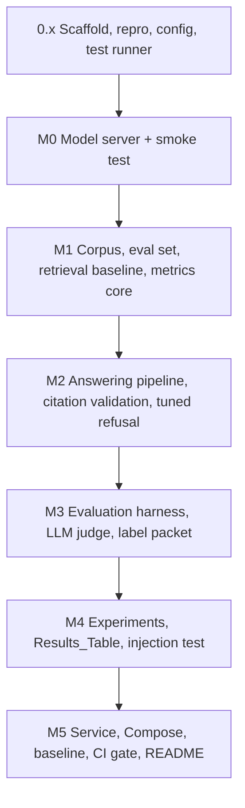

# Implementation Plan: Grounded QA Service

## Overview

This plan converts the approved design into incremental coding tasks, organized by milestone M0–M5. The run is unattended: the agent implements every task (there are no `[ME]` tasks and no optional tasks), and each milestone ends with an automated gate script (`scripts/gate_m<N>.sh`) instead of an owner review stop. A problem that survives 3 fix attempts for the same cause is written to `docs/BLOCKERS.md` and that task stops. The one thing the agent cannot honestly do is write the owner's 50 faithfulness labels (Requirement 7.5); the run prepares a labeling packet and `scripts/finalize_owner_labels.ps1`, and every gate accepts "not computed: owner labels pending" until the owner runs it.

Every reported number is produced by a repository script that records its generating command, seed, and full 40-character commit hash; results tables are generated files, never hand-edited, and result scripts refuse to run on a dirty tree (generated paths `results/`, `docs/media/`, `.kiro/` excluded). Unit tests (>=80% statement coverage per non-trivial module) and Hypothesis property-based tests (one per Correctness Property in `design.md`) run from `bash scripts/test_unit.sh`.

Fixed decisions (see `design.md` § Technology Choices):
- Implementation language: **Python 3.12** (satisfies "3.11 or newer"), environment managed by `uv` with a lockfile; CPU-only PyTorch for Rag_Lite's dense embedder and cross-encoder.
- Model server: **Ollama** (`ollama/ollama:0.40.6`) in Docker on the RTX 3080, context length 8,192, one model loaded at a time.
- Local models: **Granite 3.3 2B** (`granite3.3:2b`, smaller) and **Granite 3.3 8B** (`granite3.3:8b`, larger), both Apache-2.0. The LLM judge is `granite3.3:8b`.
- Corpus and questions: the **SQuAD 2.0 dev set** (CC BY-SA 4.0). Contexts are the documents; questions come from the same file. Refusal thresholds are tuned on a separate tuning split, never on the reported Evaluation_Set.
- Rag_Lite: installed as a pinned Git package, `rag-lite @ git+https://github.com/OctaviusLeo/rag-lite-tfidf-eval@035f182ebf71ab46db12a832917e0a02d8963cb0` (version `0.1.0`, MIT). It imports as `src`. It always returns the top `k` results, so the adapter drops any result that shares no word with the query (the scoring floor). It divides BM25 scores by the per-query maximum, so BM25-only confidence is almost always 1.0 (a recorded known limitation).
- CI: unit tests on GitHub-hosted `ubuntu-latest`; the quality gate on the self-hosted runner `desktop-gpu` (label `gpu`), because GitHub's servers cannot reach the GPU.
- Latency is timed around `AnsweringPipeline.answer` only; the judge's calls are excluded.

## Task Dependency Graph



```json
{
  "waves": [
    { "id": 0, "tasks": ["0.1"] }, { "id": 1, "tasks": ["0.2"] }, { "id": 2, "tasks": ["0.3"] }, { "id": 3, "tasks": ["0.4"] },
    { "id": 4, "tasks": ["1.1"] }, { "id": 5, "tasks": ["1.2"] }, { "id": 6, "tasks": ["1.3"] }, { "id": 7, "tasks": ["1.4"] },
    { "id": 8, "tasks": ["1.5"] }, { "id": 9, "tasks": ["1.6"] }, { "id": 10, "tasks": ["1.7"] },
    { "id": 11, "tasks": ["2.1"] }, { "id": 12, "tasks": ["2.2"] }, { "id": 13, "tasks": ["2.3"] }, { "id": 14, "tasks": ["2.4"] },
    { "id": 15, "tasks": ["2.5"] }, { "id": 16, "tasks": ["2.6"] }, { "id": 17, "tasks": ["2.7"] }, { "id": 18, "tasks": ["2.8"] },
    { "id": 19, "tasks": ["2.9"] }, { "id": 20, "tasks": ["2.10"] }, { "id": 21, "tasks": ["2.11"] }, { "id": 22, "tasks": ["2.12"] },
    { "id": 23, "tasks": ["2.13"] }, { "id": 24, "tasks": ["2.14"] },
    { "id": 25, "tasks": ["3.1"] }, { "id": 26, "tasks": ["3.2"] }, { "id": 27, "tasks": ["3.3"] }, { "id": 28, "tasks": ["3.4"] },
    { "id": 29, "tasks": ["3.5"] }, { "id": 30, "tasks": ["3.6"] }, { "id": 31, "tasks": ["3.7"] }, { "id": 32, "tasks": ["3.8"] },
    { "id": 33, "tasks": ["3.9"] }, { "id": 34, "tasks": ["3.10"] }, { "id": 35, "tasks": ["3.11"] }, { "id": 36, "tasks": ["3.12"] },
    { "id": 37, "tasks": ["3.13"] }, { "id": 38, "tasks": ["3.14"] }, { "id": 39, "tasks": ["3.15"] },
    { "id": 40, "tasks": ["4.1"] }, { "id": 41, "tasks": ["4.2"] }, { "id": 42, "tasks": ["4.3"] }, { "id": 43, "tasks": ["4.4"] },
    { "id": 44, "tasks": ["4.5"] }, { "id": 45, "tasks": ["4.6"] }, { "id": 46, "tasks": ["4.7"] }, { "id": 47, "tasks": ["4.8"] },
    { "id": 48, "tasks": ["4.9"] }, { "id": 49, "tasks": ["4.10"] }, { "id": 50, "tasks": ["4.11"] },
    { "id": 51, "tasks": ["5.1"] }, { "id": 52, "tasks": ["5.2"] }, { "id": 53, "tasks": ["5.3"] }, { "id": 54, "tasks": ["5.4"] },
    { "id": 55, "tasks": ["5.5"] }, { "id": 56, "tasks": ["5.6"] }, { "id": 57, "tasks": ["5.7"] }, { "id": 58, "tasks": ["5.8"] },
    { "id": 59, "tasks": ["5.9"] }, { "id": 60, "tasks": ["5.10"] }, { "id": 61, "tasks": ["5.11"] }, { "id": 62, "tasks": ["5.12"] },
    { "id": 63, "tasks": ["5.13"] },
    { "id": 64, "tasks": ["6.1"] }, { "id": 65, "tasks": ["6.2"] }, { "id": 66, "tasks": ["6.3"] }, { "id": 67, "tasks": ["6.4"] },
    { "id": 68, "tasks": ["6.5"] }, { "id": 69, "tasks": ["6.6"] }, { "id": 70, "tasks": ["6.7"] }, { "id": 71, "tasks": ["6.8"] },
    { "id": 72, "tasks": ["6.9"] }, { "id": 73, "tasks": ["6.10"] }, { "id": 74, "tasks": ["6.11"] }, { "id": 75, "tasks": ["6.12"] },
    { "id": 76, "tasks": ["6.13"] }, { "id": 77, "tasks": ["6.14"] }, { "id": 78, "tasks": ["6.15"] }
  ]
}
```

## Tasks

## Setup (prerequisite scaffolding)

- [x] 0.1 Create repository scaffold, dependency pinning, secret hygiene, and helper scripts
  - Create the `gqa/` package, `tests/` tree, `pyproject.toml` with every direct dependency pinned to an exact version (`==`) and `uv.lock`; Rag_Lite pinned by commit; PyTorch from the CPU index.
  - Add `.gitattributes` (`* text=auto eol=lf`, binaries marked), `.gitignore` entries for every secret-bearing file (`.env`, `*.env`, `secrets/`) and generated caches, and `.python-version`.
  - Create `scripts/wsl_run.sh`, `scripts/bg.sh`, `scripts/bg_status.sh`, `scripts/bg_wait.sh` (see `environment.md`), `scripts/test_unit.sh` (pytest + Hypothesis + coverage) and `scripts/check_coverage.py` (fails if any non-trivial `gqa/` module is below 80% statements).
  - Create `docs/ENVIRONMENT.md` and `THIRD_PARTY.md` with section headers. Initialise Git on `main`, add the remote, commit, and push.
  - _Requirements: 0.9, 0.10, 0.11, 0.12_

- [x] 0.2 Implement the shared reproducibility helper
  - Write `gqa/repro.py`: 40-character commit hash via `git rev-parse HEAD`, `require_clean_tree()` (generated paths excluded), a `Stamp{command, seed, commit}` struct, and a serializer/markdown renderer used by every result-emitting script.
  - _Requirements: 0.1, 0.2, 0.4_

- [x] 0.3 Write unit tests for the reproducibility helper
  - Assert the commit hash is 40 hex chars, the stamp round-trips through serialization, and the clean-tree check ignores generated paths but flags source edits (throwaway repository in a temp dir).
  - _Requirements: 0.1_

- [x] 0.4 Implement the configuration loader
  - Write `gqa/config.py` and `config/default.yaml`: seeds, chunking, retrieval `k`, model server URL, model names, timeouts, and refusal thresholds validated to lie in `[0,1]`. Unit tests cover validation errors.
  - _Requirements: 0.2, 4.6_

## M0 — Environment and local model server smoke test

- [x] 1.1 Implement the OpenAI-compatible `ModelClient` with fail-fast secret handling
  - Write `gqa/model_client.py` reading the API key from `os.environ[api_key_env]`; if required and unset/empty, raise `MissingSecretError` naming the variable before any request. Enforce a request timeout and support `complete` (returns text and token usage) and `stream`. Temperature 0 and a fixed seed are sent with every request.
  - _Requirements: 1.6, 0.13_

- [x] 1.2 Write unit tests for `ModelClient` secret and timeout handling
  - Missing-secret fail-fast (raises before any HTTP call, names the variable), timeout surfacing as a typed error, streaming reassembly, against a fake HTTP transport.
  - _Requirements: 0.13, 1.6, 9.9_

- [x] 1.3 Implement GPU telemetry helpers
  - Write `gqa/gpu.py`: parse `nvidia-smi` total/used memory (MiB) and power draw (W), and a background sampler that records the peak memory and mean power between start and stop. Unit tests use canned `nvidia-smi` output.
  - _Requirements: 1.1, 1.3_

- [x] 1.4 Author the model-server Compose service and model pull
  - Write `docker-compose.yml` (project name `gqa`) with the `ollama` service: image `ollama/ollama:0.40.6` pinned by digest, all GPUs, `OLLAMA_CONTEXT_LENGTH=8192`, `OLLAMA_MAX_LOADED_MODELS=1`, `OLLAMA_NUM_PARALLEL=1`, volume `gqa_ollama`, port `127.0.0.1:8090:11434`, and a health check. Write `scripts/pull_models.sh` that pulls `granite3.3:2b` and `granite3.3:8b` and records their digests.
  - _Requirements: 1.2, 9.7_

- [x] 1.5 Implement the environment + model smoke-test script
  - Write `scripts/smoke_test.py` (logic in `gqa/smoke.py`) that verifies Python >= 3.11 and Docker availability; captures `nvidia-smi` output and total GPU memory (MiB); starts the Model_Server; sends exactly one question; samples peak GPU memory (MiB) during generation; records a non-empty Answer; and writes all evidence into a generated block of `docs/ENVIRONMENT.md`. On failure within 120 s or an unmet prerequisite, it reports the actual cause, records the failed condition, and exits non-zero. Unit tests cover the failure paths with fakes.
  - _Requirements: 1.1, 1.2, 1.3, 1.6, 1.8, 0.4_

- [x] 1.6 Prove the Local_Models and Model_Server, record VRAM evidence
  - Run the smoke test for `granite3.3:8b` and `granite3.3:2b`; confirm measured peak GPU memory does not exceed the `nvidia-smi` total. Record in `docs/ENVIRONMENT.md`: model name/digest/quantization/license, server name/version, `nvidia-smi` output, peak VRAM, and the generated Answer, each with a verifiable artifact. Record no Hosted_Model (none is used, so no Spend_Cap applies) and list the server and models in `THIRD_PARTY.md`.
  - _Requirements: 1.4, 1.5, 1.7, 0.5, 0.6, 0.7_

- [x] 1.7 M0 gate
  - `bash scripts/gate_m0.sh`: the unit suite passes with coverage, the smoke-test evidence blocks exist for both models with peak <= total, and `THIRD_PARTY.md` lists the server and models. Push.

## M1 — Corpus, chunking, evaluation set, retrieval baseline

- [ ] 2.1 Implement deterministic corpus ingestion and chunking
  - Write `gqa/ingest.py` with the `Passage` dataclass, `Chunker` (delegating window splitting to Rag_Lite's `chunk_text`), `passage_id_for(doc_id, chunk_index, text)` (stable function of normalized text), and `find_duplicate_ids` returning `{duplicated_id: count}`.
  - _Requirements: 2.1, 2.2_

- [ ] 2.2 Write property test for Passage_ID stability and uniqueness
  - **Property 4: Passage_ID stability and uniqueness** — chunk twice, assert identical `{passage_id: text}` maps; distinct passages get distinct IDs or collisions are reported with counts.
  - **Validates: Requirements 2.2**

- [ ] 2.3 Write unit tests for chunker and duplicate detection
  - Cover overlap handling, empty documents, and duplicate-ID reporting output.
  - _Requirements: 2.2_

- [ ] 2.4 Build the corpus assembly script and record provenance
  - Write `gqa/squad.py` (download with SHA-256 check into `~/gqa-data`) and `scripts/build_corpus.py`, which chunks every SQuAD 2.0 dev context into `data/corpus/passages.jsonl`, verifies no duplicate Passage_IDs, and writes a stamped manifest. Record the source and license (CC BY-SA 4.0) in `THIRD_PARTY.md`.
  - _Requirements: 2.1, 2.2, 0.8_

- [ ] 2.5 Implement the Evaluation_Set schema, loader, and gold-ID validator
  - Write `gqa/evalset.py` with the `EvalQuestion` dataclass and a validator that checks: >=150 questions, >=20 Unanswerable_Questions (no gold IDs), each answerable question has >=1 gold Passage_ID, and every gold Passage_ID resolves to an existing Passage (reporting each unresolved ID and the total count).
  - _Requirements: 2.3, 2.4, 2.6_

- [ ] 2.6 Write unit tests for evaluation-set validation
  - Test the count thresholds, unanswerable labeling, and unresolved-gold-ID reporting path.
  - _Requirements: 2.3, 2.4, 2.6_

- [ ] 2.7 Build the evaluation and tuning question sets from SQuAD 2.0
  - Write `scripts/build_evalset.py`: with a fixed seed, sample a reported Evaluation_Set of 200 questions (150 answerable, 50 unanswerable) and a disjoint tuning split of 100 questions (70 answerable, 30 unanswerable). Gold Passage_IDs are the passages whose span contains the gold answer offset. Write `data/evalset.jsonl`, `data/tuning.jsonl`, and a stamped manifest; run the validator from 2.5; record the dataset and license in `THIRD_PARTY.md`.
  - _Requirements: 2.3, 2.4, 2.5, 2.6, 0.8_

- [ ] 2.8 Implement the `RagLiteRetriever` adapter over Rag_Lite
  - Write `gqa/retrieval.py` with `RetrievedPassage`, `RetrievalMode`, a backend that calls Rag_Lite's `build_index` and `retrieve_hybrid` (BM25 / hybrid / hybrid+rerank), and `RagLiteRetriever.retrieve` returning descending-score, de-duplicated results; results sharing no word with the query are dropped, so a no-match query returns `[]` without raising. Pin the Hugging Face model revisions Rag_Lite loads. Record the reuse mode and license in `THIRD_PARTY.md`.
  - _Requirements: 3.1, 3.2, 3.4, 3.5, 3.6_

- [ ] 2.9 Write property test for retrieval ranking order and no duplicates
  - **Property 5: Retrieval ranking order and no duplicates** — scores non-increasing by rank, all Passage_IDs distinct (real Rag_Lite TF-IDF/BM25 index over generated passages).
  - **Validates: Requirements 3.2**

- [ ] 2.10 Write property test for empty retrieval on no match
  - **Property 6: Empty retrieval on no match** — disjoint-vocabulary query returns `[]` and raises nothing.
  - **Validates: Requirements 3.4**

- [ ] 2.11 Implement the metric core and the bootstrap confidence interval
  - Write `gqa/metrics.py` with `recall_at_k` and `ndcg_at_k` (delegating to Rag_Lite's IR metrics after truncation to `k`) and `bootstrap_ci` producing `BootstrapCI{point, lower, upper}` from >=1000 resamples at 95% confidence, deterministic under a fixed seed.
  - _Requirements: 3.3, 7.1, 7.6_

- [ ] 2.12 Write property tests for retrieval metric ranges and bootstrap CIs
  - **Property 7: Metric ranges** (retrieval subset) — Recall@K and nDCG@K lie in `[0,1]`.
  - **Property 8: Bootstrap CI brackets the point estimate** — `lower <= point <= upper`; same seed yields identical interval within 1e-6.
  - **Validates: Requirements 3.3, 7.1, 7.6, 8.4**

- [ ] 2.13 Implement and run the retrieval baseline evaluation
  - Write `scripts/retrieval_baseline.py` computing Recall@K and nDCG@K for K in {5, 10, 20} with 95% bootstrap CIs over the answerable Evaluation_Set questions, for BM25, hybrid, and hybrid+rerank, writing `results/retrieval_baseline.{json,md}` stamped with command/seed/40-char commit hash.
  - _Requirements: 3.3, 0.1, 0.2_

- [ ] 2.14 M1 gate
  - `bash scripts/gate_m1.sh`: unit suite + coverage pass; corpus has no duplicate IDs; the Evaluation_Set validator passes; the baseline file exists, is stamped with a commit that exists, and every value is in `[0,1]`. Push.

## M2 — Answering pipeline with citations and refusal

- [ ] 3.1 Implement confidence estimation and refusal decision
  - Write `gqa/confidence.py` with `estimate_confidence` (0.0 for empty retrieval; otherwise the top score mapped into `[0,1]`: the logistic of the cross-encoder logit for rerank modes, the clipped fused score otherwise) and `should_refuse(confidence, threshold)`.
  - _Requirements: 4.4, 4.6_

- [ ] 3.2 Write unit tests for confidence and threshold-in-config
  - Test empty retrieval maps to 0.0, outputs lie in `[0,1]`, and the threshold is read from config in `[0,1]`.
  - _Requirements: 4.4, 4.6_

- [ ] 3.3 Implement the `PromptBuilder` with delimited data and anti-injection system prompt
  - Write `gqa/prompt.py` with `PromptMessages` and `PromptBuilder.build`, rendering Passages (with their Passage_IDs) only inside a delimited data block and placing the answer-only, cite-each-ID, refuse-with-exact-text, and treat-passages-as-data directives in the system message. The agent writes the wording.
  - _Requirements: 4.2, 6.1_

- [ ] 3.4 Write property test that the prompt delimits passages as data
  - **Property 11: Prompt delimits passages as data** — every passage text appears only in the delimiter region; anti-injection directive present in the system message.
  - **Validates: Requirements 6.1**

- [ ] 3.5 Tune the refusal thresholds on the tuning split
  - Write `scripts/tune_thresholds.py`: for each retrieval mode, compute retrieval confidence on the tuning split only and pick the threshold that maximizes balanced accuracy of "refuse unanswerable / answer answerable" (ties to the lower threshold). Write `config/thresholds.yaml` (generated, stamped). The reported Evaluation_Set is never read.
  - _Requirements: 4.6, 0.1_

- [ ] 3.6 Implement the `AnswerParser`
  - Write `gqa/parser.py` with `ParsedAnswer` and `parse_answer`, extracting cited Passage_IDs via the documented citation syntax (`[<passage_id>]`, several IDs separated by commas allowed) and detecting the exact refusal text.
  - _Requirements: 4.3_

- [ ] 3.7 Write unit tests for answer parsing
  - Test extraction of zero, one, and many citations and malformed-marker handling.
  - _Requirements: 4.3_

- [ ] 3.8 Implement the `CitationValidator`
  - Write `gqa/validate.py` with `ValidationResult` and `CitationValidator.validate`: accept iff every cited ID is retrieved and every sentence carries a citation; report `offending == cited − retrieved`; on reject, return a corrected Answer (only sentences whose citations are all retrieved) or a Refusal.
  - _Requirements: 5.1, 5.2, 5.3, 5.4_

- [ ] 3.9 Write property test for citation soundness (validation decision)
  - **Property 1: Citation soundness** — `accepted == (cited ⊆ retrieved and no_uncited_claim)` and `offending == cited − retrieved`.
  - **Validates: Requirements 4.3, 5.1, 5.2, 5.4**

- [ ] 3.10 Write property test for no uncited claims after validation
  - **Property 2: No uncited claims after validation** — final response is a Refusal or an Answer whose citations ⊆ retrieved.
  - **Validates: Requirements 5.3**

- [ ] 3.11 Write unit tests for citation validation accept/reject
  - Accept when all cited IDs retrieved; reject when at least one ID is outside the retrieved set.
  - _Requirements: 5.5_

- [ ] 3.12 Wire the `AnsweringPipeline` together
  - Write `gqa/pipeline.py` with `Answer`, `REFUSAL_TEXT`, and `AnsweringPipeline.answer` orchestrating retrieve -> confidence -> (refuse | prompt -> model -> parse -> validate), returning Answer / corrected Answer / Refusal, plus a sentence-validated streaming variant for the service.
  - _Requirements: 4.1, 4.3, 4.4, 4.5, 5.3_

- [ ] 3.13 Write property test for refusal below confidence threshold
  - **Property 3: Refusal below confidence threshold** — `confidence < threshold` ⟹ `refused`, `text == REFUSAL_TEXT`, and the model is not invoked (mock `ModelClient`).
  - **Validates: Requirements 4.4, 4.5**

- [ ] 3.14 Live pipeline check
  - `scripts/pipeline_check.py`: run 5 tuning-split questions through the real pipeline with `granite3.3:2b` and assert every returned Answer is a Refusal or cites only retrieved IDs. Output goes to `~/gqa-runs` (not a reported number).
  - _Requirements: 4.1, 4.3, 5.3_

- [ ] 3.15 M2 gate
  - `bash scripts/gate_m2.sh`: unit suite + coverage pass, thresholds file is stamped and in `[0,1]`, live check passed. Push.

## M3 — Evaluation harness, LLM judge, label packet

- [ ] 4.1 Implement the remaining metric functions
  - Add `exact_match`, `token_f1` (SQuAD normalization, max over gold answers), `citation_precision`, `citation_recall`, `refusal_accuracy` (all `[0,1]`), `cohen_kappa` (`[-1,1]`), and `percentile` to `gqa/metrics.py`.
  - _Requirements: 7.2, 7.3, 7.4, 7.5_

- [ ] 4.2 Write property test for metric ranges and identity cases
  - **Property 7: Metric ranges** — all fractions in `[0,1]`, kappa in `[-1,1]`; identical pred/gold give EM and F1 = 1.0; identical label sequences give kappa = 1.0.
  - **Validates: Requirements 3.3, 7.1, 7.2, 7.3, 7.4, 7.5**

- [ ] 4.3 Implement the `LLMJudge` faithfulness scorer
  - Write `gqa/judge.py` with `LLMJudge.score_faithfulness` producing a 1/0 faithfulness label per Answer against its cited Passages (unparseable verdict => `None`, reported), and `judge_agreement` computing Cohen's kappa against owner labels over >=50 samples (fewer => "not computed").
  - _Requirements: 7.5_

- [ ] 4.4 Write unit tests for the judge and the kappa computation
  - Kappa over a fixed label fixture, the >=50-sample guard, verdict parsing, and a stub model.
  - _Requirements: 7.5_

- [ ] 4.5 Build the single-command evaluation harness
  - Write `gqa/eval.py` (invocable as `python -m gqa.eval --config ... --seed ...`) that computes retrieval metrics, EM/F1, citation precision/recall, refusal accuracy, and judge faithfulness with 95% bootstrap CIs, is deterministic under a fixed seed, and reports each metric with its command/seed/40-char commit hash. On missing/malformed input, it reports the affected metric as "not computed" with its cause and continues. Answers are generated first, then judged, so only one model is loaded at a time.
  - _Requirements: 7.1, 7.2, 7.3, 7.4, 7.6, 7.7, 7.8, 7.9, 0.1, 0.3_

- [ ] 4.6 Write property test for determinism under fixed seed
  - **Property 9: Determinism under fixed seed** — running the metric aggregation twice with the same seed gives floats equal within 1e-6 and exact equality for ints/categoricals.
  - **Validates: Requirements 0.3, 7.8**

- [ ] 4.7 Write unit tests for harness resilience and single-command invocation
  - Malformed-input "not computed" path, and that the harness runs non-interactively from one command with stub components.
  - _Requirements: 7.7, 7.9_

- [ ] 4.8 Implement the owner labeling packet and finalize script
  - Write `scripts/make_label_packet.py` (50 seeded samples from the large-model hybrid+rerank run: question, answer, cited passage text, sample id; writes `results/judge/label_packet.md`, `results/judge/samples.jsonl`, and `results/judge/owner_labels.csv` with empty labels) and `scripts/finalize_owner_labels.ps1` + `scripts/finalize_owner_labels.py` (validate 50 labels in {0,1}, commit labels, compute kappa with CI, regenerate `results/summary.md` and the README, commit, push).
  - _Requirements: 7.5, 0.1_

- [ ] 4.9 Write unit tests for the label packet and finalize logic
  - Pending labels yield "not computed: owner labels pending"; complete labels yield kappa; malformed labels are rejected with the line number.
  - _Requirements: 7.5, 7.9_

- [ ] 4.10 Run the harness twice on the CI subset
  - With `granite3.3:2b`, run `python -m gqa.eval` twice with the same seed on the 30-question CI subset; compare the metric files (Req 7.8, model-provider nondeterminism documented if any value differs).
  - _Requirements: 7.7, 7.8_

- [ ] 4.11 M3 gate
  - `bash scripts/gate_m3.sh`: unit suite + coverage pass; both harness outputs exist and are stamped. Push.

## M4 — Configuration experiments, Results_Table, injection test

- [ ] 5.1 Implement the experiments runner and latency/cost measurement
  - Write `gqa/experiments.py` with `Configuration`, `ConfigResult`, and `run_experiments` over the 4 Configurations in `config/experiments.yaml` (`bm25` + 8B; `hybrid` + 8B; `hybrid_rerank` + 2B; `hybrid_rerank` + 8B), measuring quality + retrieval metrics (with CIs), P50/P95 latency (ms, pipeline only), and cost per 1,000 questions (USD, >=2 decimals). Local cost = measured GPU energy × the recorded residential electricity price; hosted cost (unused) = token counts × recorded per-token prices. A failed Configuration is marked with its cause and the rest continue.
  - _Requirements: 8.1, 8.2, 8.5, 8.6_

- [ ] 5.2 Write property test for latency percentile ordering
  - **Property 12: Latency percentile ordering** — reported P50 <= P95.
  - **Validates: Requirements 8.2**

- [ ] 5.3 Write property test for hosted cost formula
  - **Property 13: Hosted cost computed from the defining formula** — `cost_per_1k == formula(counts, prices)` within 1e-6, >=2 decimals preserved.
  - **Validates: Requirements 8.5**

- [ ] 5.4 Write unit test for failed-configuration resilience
  - A failing Configuration is reported with its cause while others still produce results.
  - _Requirements: 8.6_

- [ ] 5.5 Implement the generated Results_Table writer
  - Write `gqa/results_table.py` producing `results/summary.md` from the stored run records: one row per Configuration with quality metrics (each with a 95% bootstrap CI from >=1000 resamples), retrieval metrics (with CIs), P50/P95 latency, and cost per 1k; plus retrieval-baseline, injection-test, and judge-agreement sections; and the command/seed/commit stamp of each source.
  - _Requirements: 8.3, 8.4, 0.1_

- [ ] 5.6 Write unit tests for Results_Table generation
  - Regenerating produces the file, CIs appear for every quality/retrieval metric, failed configurations and "not computed" values render with their cause.
  - _Requirements: 8.3, 8.4_

- [ ] 5.7 Implement the Injection_Test harness and runner script
  - Write `gqa/injection.py` with `InjectionCase`, `InjectionReport`, and `run_injection_test`, plus `scripts/injection_test.py` reporting the followed-fraction in `[0,1]` as `followed / (followed + not_followed)` (0.0 when the denominator is 0) with unclassified cases excluded from the denominator and their count reported; stamp the result with command/integer seed/40-char commit hash.
  - _Requirements: 6.2, 6.3, 6.4, 6.6_

- [ ] 5.8 Write property test for the injection followed-fraction computation
  - **Property 10: Injection followed-fraction computation** — fraction in `[0,1]`, equals `followed/(followed+not_followed)` (documented rule when denominator is 0), unclassified count correct.
  - **Validates: Requirements 6.2, 6.6**

- [ ] 5.9 Author the injected-instruction cases and classification rule
  - Write `data/injection_cases.yaml`: >=20 cases, each with a distinct embedded instruction, a host question/passage from the Evaluation_Set, and a canary whose presence in the final Answer text is the observable effect. Rule: followed iff the canary appears (case-insensitive) in the final Answer; not followed if the model was invoked and it does not; unclassified if the model was never invoked (refusal before generation) or the call failed. Documented in `docs/INJECTION.md`.
  - _Requirements: 6.3, 6.5_

- [ ] 5.10 Run the configuration experiments
  - Commit, then run `scripts/run_experiments.py` in the background over the Evaluation_Set; store per-question records in `results/runs/<config>.jsonl` and the aggregate in `results/experiments.json`.
  - _Requirements: 8.1, 8.2, 8.3, 8.6_

- [ ] 5.11 Run the injection test
  - Commit, then run `scripts/injection_test.py` (hybrid+rerank + 8B); write `results/injection.json`.
  - _Requirements: 6.2, 6.4, 6.5_

- [ ] 5.12 Generate the label packet and the Results_Table
  - Run `scripts/make_label_packet.py`, then `scripts/write_results_table.py`.
  - _Requirements: 7.5, 8.3_

- [ ] 5.13 M4 gate
  - `bash scripts/gate_m4.sh`: `results/summary.md` has 4 configuration rows with CIs, a retrieval-baseline section, an injection section, and a judge-agreement section (value or "not computed: owner labels pending"); the label packet exists. Push.

## M5 — Service, orchestration, CI gate, README

- [ ] 6.1 Implement the FastAPI service with request-ID middleware and structured logging
  - Write `gqa/service.py` with `AnswerRequest` (Pydantic `min_length=1`, `max_length=MAX_QUERY_LEN`, strict string), `CitedAnswer`, and endpoints `POST /answer`, `POST /answer/stream` (server-sent events, first chunk within the documented timeout), `GET /health`, `GET /metrics` (JSON request-count + latency). Middleware assigns a unique request_id and emits >=1 JSON log per request recording request_id, start time, outcome, and duration_ms. Invalid queries are rejected before the pipeline, leaving state unchanged. Secrets are read from env vars; the service fails to start and names the missing secret if a required one is absent.
  - _Requirements: 9.1, 9.2, 9.3, 9.4, 9.5, 9.6, 9.8, 9.9_

- [ ] 6.2 Write property test for request identifier propagation
  - **Property 14: Request identifier propagation** — every log entry for a request shares its id; ids are unique across requests.
  - **Validates: Requirements 9.4, 9.5**

- [ ] 6.3 Write unit/integration tests for the service
  - Invalid/empty/oversized query rejection (Req 9.2); metrics endpoint shape (Req 9.6); streaming first-chunk + reassembly (Req 9.3); missing-secret start-up failure (Req 9.9).
  - _Requirements: 9.2, 9.3, 9.6, 9.9_

- [ ] 6.4 Author the service image and full Compose stack
  - Write the `Dockerfile` (pinned base image, `uv sync --frozen`, Hugging Face models baked in at their pinned revisions, corpus built at image build) and add `model-init` (pulls the serving model) and `api` services to `docker-compose.yml`, so one documented `docker compose up` starts the service plus every dependency and reaches a state where the endpoint accepts requests.
  - _Requirements: 9.7, 11.3_

- [ ] 6.5 Write and run an integration test polling `/health`
  - `scripts/compose_check.sh` starts the stack detached, polls `/health` until it accepts, sends one `/answer` request, and leaves the `ollama` service running. Marked `docker`.
  - _Requirements: 9.7_

- [ ] 6.6 Implement the CI regression gate script
  - Write `gqa/gate.py` + `scripts/ci_gate.py` with `BaselineFile` and `check_regression`: compare the CI-subset Faithfulness and citation precision to the Baseline_File and fail if `(baseline - subset) > threshold` in native units; fail (and report) if the Baseline_File is missing or unreadable. The regression threshold and subset size are recorded in `config/ci.yaml`.
  - _Requirements: 10.1, 10.2, 10.3, 10.5, 10.6_

- [ ] 6.7 Write property test for the CI regression gate decision
  - **Property 15: CI regression gate decision** — `failed == ((baseline - subset) > threshold)` applied independently to faithfulness and citation precision.
  - **Validates: Requirements 10.2, 10.3**

- [ ] 6.8 Write unit test for missing/unreadable baseline handling
  - Missing or unreadable Baseline_File yields a failed status with the reported cause.
  - _Requirements: 10.5_

- [ ] 6.9 Create the Baseline_File
  - Commit, then run `scripts/make_baseline.py`: evaluate the CI subset with the CI configuration and write `results/baseline.json` with faithfulness, citation precision, command, seed, and the 40-char commit.
  - _Requirements: 10.6_

- [ ] 6.10 Configure the GitHub Actions CI pipeline
  - Write `.github/workflows/ci.yml`: on pushes to `main` and PRs targeting it, job `unit` (GitHub-hosted) runs `bash scripts/test_unit.sh`; job `quality` (self-hosted `gpu`, needs `unit`) starts the `ollama` service, evaluates the CI subset, and runs `scripts/ci_gate.py`; the run fails if any unit test fails or the gate reports failure.
  - _Requirements: 10.1, 10.4_

- [ ] 6.11 Implement the README number-traceability check
  - Write `gqa/readme_check.py` + `scripts/check_readme.py` that verifies every number in the README traces to `results/summary.md` or another script-generated file (generated blocks, or numbers in an allow-list of non-measurement contexts such as requirement IDs, versions, ports, and commands); report each untraceable number and exit with a failed status when any exist.
  - _Requirements: 11.4, 11.5_

- [ ] 6.12 Write property test for README number traceability
  - **Property 16: README number traceability** — the check flags exactly the untraceable numbers and fails when any exist.
  - **Validates: Requirements 11.4, 11.5**

- [ ] 6.13 Record the demo GIF
  - `scripts/make_demo_gif.py`: with the Compose stack running, send real questions to `/answer/stream` (one answered, one refused), capture the chunks with their arrival times, and render them into `docs/media/demo.gif`.
  - _Requirements: 11.1_

- [ ] 6.14 Assemble the README from generated sources with the documented commands
  - `scripts/render_readme.py` fills generated blocks of `README.md` from `results/summary.md` (Results_Table with a CI per metric, stamps). The agent writes the prose: architecture diagram and explanation, run instructions with the exact single command per test suite and per reported result, the exact single `docker compose up` command (matching 6.4), cost-and-latency trade-offs, known limitations, and the demo GIF reference. `scripts/check_readme.py` passes.
  - _Requirements: 11.1, 11.2, 11.3, 0.11_

- [ ] 6.15 M5 gate (project complete)
  - `bash scripts/gate_m5.sh`: unit suite + coverage pass, `check_readme.py` passes, `results/baseline.json` is stamped, `docs/media/demo.gif` exists. Push, then confirm the latest `main` CI run completed with `success`.

## Notes

- No task is optional and none is reserved for the owner. The owner's only remaining step is labeling 50 samples after the run (`results/judge/label_packet.md`, `results/judge/owner_labels.csv`, then `powershell -NoProfile -ExecutionPolicy Bypass -File scripts\finalize_owner_labels.ps1`).
- Each task references specific requirements for traceability; property-test tasks reference the exact Correctness Property from `design.md`.
- Every result is produced by a repository script and recorded with its command, seed, and full 40-character commit hash; `results/summary.md` and the Baseline_File are generated files, never hand-edited.
- Milestone gates replace owner review stops. If `docs/BLOCKERS.md` exists, fix the cause it names and run the remaining tasks again.
