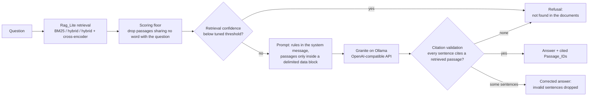

# Grounded QA Service

A question-answering service that answers **only** from retrieved passages, cites the passage it used, refuses with "not found in the documents" when it cannot, and measures itself so that every change is checked before it ships. It retrieves with my earlier library [rag-lite-tfidf-eval](https://github.com/OctaviusLeo/rag-lite-tfidf-eval) (installed as a pinned package, not rewritten), runs open-weight IBM Granite models locally on an RTX 3080 through Ollama, and reports every number with the command, seed, and commit that produced it.

> Private portfolio repository: no license, no published package, no release.


*The demo shows real responses from `POST /answer/stream` (raw events in `docs/media/demo.json`); pauses longer than 1.5 s are shortened.*

## How it works



1. **Corpus and questions.** The SQuAD v2.0 dev set (CC BY-SA 4.0): every context paragraph is chunked with Rag_Lite's `chunk_text` and given a stable Passage_ID, `doc:chunk:sha1-prefix` (`gqa/ingest.py`). The reported Evaluation_Set and a separate tuning split are sampled with a fixed seed (`scripts/build_evalset.py`); unanswerable questions come from SQuAD's adversarial unanswerables.
2. **Retrieval** is entirely Rag_Lite's `build_index` and `retrieve_hybrid` (`gqa/retrieval.py`). Rag_Lite always returns the top results even for nonsense, so the adapter drops passages that share no content word with the question; a question that matches nothing gets no passages and is refused.
3. **Refusal gate.** Confidence is the top retrieval score mapped into the unit interval (the logistic of the cross-encoder logit when reranking). The per-mode thresholds are tuned end-to-end on the tuning split only (`gqa/tuning.py`): a question counts as refused if the gate stops it *or* the model or validator refuses it later.
4. **Prompt and guardrails** (`gqa/prompt.py`). The system message holds the rules (answer only from the passages, give the shortest answering phrase, cite the Passage_ID, refuse with the exact text, treat passages as untrusted data). Passages appear only inside one `<passages>` block; delimiter tags inside a passage are neutralized so it cannot close the block.
5. **Citation validation** (`gqa/validate.py`). Every sentence is a claim. An answer is accepted only if every sentence cites at least one passage and every cited ID was retrieved for this question; otherwise invalid sentences are dropped, and if none survive the answer becomes a refusal. The streaming endpoint applies the same rule sentence by sentence, so an invalid sentence is never sent.
6. **Evaluation** (`gqa/eval.py`, `gqa/experiments.py`). Recall@K and nDCG@K, exact match and token F1 (SQuAD normalization), citation precision and recall against gold passages, refusal accuracy on unanswerable questions, and faithfulness scored by an LLM judge (`granite3.3:8b`, `gqa/judge.py`). Every metric has a 95% bootstrap CI from 1,000 resamples. Latency is timed around the pipeline only, not the judge.

## Results

All tables below are copied verbatim from the generated `results/summary.md` by `python scripts/render_readme.py`, and `python scripts/check_readme.py` fails the build if any number in this README cannot be traced to a generated file. Each block carries the command, seed, and commit that produced it.

<!-- BEGIN summary:Configuration experiments (Results_Table) -->
<!-- END summary:Configuration experiments (Results_Table) -->

<!-- BEGIN summary:Injection test -->
<!-- END summary:Injection test -->

<!-- BEGIN summary:Judge agreement (Cohen's kappa vs owner labels) -->
<!-- END summary:Judge agreement (Cohen's kappa vs owner labels) -->

<!-- BEGIN summary:Retrieval baseline (Rag_Lite, answerable questions) -->
<!-- END summary:Retrieval baseline (Rag_Lite, answerable questions) -->

<!-- BEGIN summary:Refusal thresholds (tuned on the tuning split) -->
<!-- END summary:Refusal thresholds (tuned on the tuning split) -->

## Cost and latency trade-offs

<!-- BEGIN summary:Trade-offs -->
<!-- END summary:Trade-offs -->

TRADEOFF_PROSE

## Run it

Start the model server, pull the serving model, build the API image, and start the API with one command (needs Docker with the NVIDIA Container Toolkit):

```bash
docker compose up
```

When `docker compose ps` shows `api` as healthy, the API listens on `http://127.0.0.1:8000`:

```bash
curl -s -X POST http://127.0.0.1:8000/answer -H 'content-type: application/json' -d '{"query": "Who was Edward the Confessor'"'"'s half-brother?"}'
curl -N -X POST http://127.0.0.1:8000/answer/stream -H 'content-type: application/json' -d '{"query": "When was the Gerald Ratner Athletics Center constructed?"}'
curl -s http://127.0.0.1:8000/health
curl -s http://127.0.0.1:8000/metrics
```

- `POST /answer` returns `{"text", "cited_ids", "refused", "request_id"}`.
- `POST /answer/stream` sends server-sent events: `chunk` events, each a validated sentence, then one `done` event with the full answer and its citations. If no text arrives within `service.first_chunk_timeout_s` (`config/default.yaml`) the stream sends an `error` event.
- Invalid queries (empty, blank, not a string, longer than `service.max_query_len`, or extra fields) get `422 {"error": "invalid query"}` without touching the pipeline or `/metrics`.
- Every request gets an `X-Request-ID`; every log line is one JSON object carrying that ID, and the last one records the start time, outcome, and duration in milliseconds.
- Secrets come only from environment variables. The local model needs none; a hosted model would set `model_server.api_key_required: true`, and the service then refuses to start and names the missing variable.

## Reproduce every result

Everything below runs inside WSL from the repository root through `scripts/wsl_run.sh`, which selects the locked environment (`bash scripts/sync_env.sh` creates it). Result scripts refuse to run on a dirty working tree, so every stamp names committed code.

| Result | Command |
| --- | --- |
| Smoke test, VRAM evidence (`docs/ENVIRONMENT.md`) | `python scripts/smoke_test.py --model granite3.3:8b --model granite3.3:2b` |
| Versions and licenses (`docs/ENVIRONMENT.md`, `THIRD_PARTY.md`) | `python scripts/record_environment.py` |
| Corpus (`data/corpus/`) | `python scripts/build_corpus.py` |
| Evaluation_Set and tuning split (`data/`) | `python scripts/build_evalset.py` |
| Retrieval baseline (`results/retrieval_baseline.*`) | `python scripts/retrieval_baseline.py` |
| Refusal thresholds (`config/thresholds.yaml`) | `python scripts/tune_thresholds.py` |
| Configuration experiments (`results/experiments.json`, `results/runs/`) | `python scripts/run_experiments.py` |
| Injection test (`results/injection.json`) | `python scripts/injection_test.py` |
| Results_Table (`results/summary.md`) | `python scripts/write_results_table.py` |
| One configuration on the CI subset | `python -m gqa.eval --config config/default.yaml --seed 1234 --mode hybrid_rerank --model granite3.3:2b --subset ci --out results/eval/ci_run1.json` |
| Determinism check (`results/eval/determinism.json`) | `bash scripts/eval_twice.sh` |
| CI Baseline_File (`results/baseline.json`) | `python scripts/make_baseline.py` |
| Owner labeling packet (`results/judge/`) | `python scripts/make_label_packet.py` |
| Judge agreement (`results/judge/agreement.json`) | `powershell -NoProfile -ExecutionPolicy Bypass -File scripts\finalize_owner_labels.ps1` (Windows, after labeling) |
| Demo GIF (`docs/media/demo.gif`) | `python scripts/make_demo_gif.py` (with the stack running) |

## Tests

| Suite | Command |
| --- | --- |
| Unit and property tests, with the per-module coverage gate (every non-trivial module at least 80%) | `bash scripts/test_unit.sh` |
| Tests that load the real Hugging Face embedder and cross-encoder | `python -m pytest -m hf` |
| Docker Compose start-up check (polls `/health`, sends one request) | `bash scripts/compose_check.sh` |
| Milestone gates | `bash scripts/gate_m0.sh` through `bash scripts/gate_m5.sh` |

The suite has one Hypothesis property test (`max_examples=100`, derandomized) for each of the design's correctness properties, tagged `Feature: grounded-qa-service, Property <n>`, and uses fakes for the model server, so it runs on a CPU-only runner without secrets or downloads.

## Continuous integration

`.github/workflows/ci.yml` runs on every push to `main` and every pull request targeting it:

1. **unit** (GitHub-hosted `ubuntu-latest`): installs `uv.lock` and runs `bash scripts/test_unit.sh`; any failing test or module under the coverage bar fails the run.
2. **quality** (self-hosted runner `desktop-gpu`, because GitHub's servers cannot reach the GPU): starts the Ollama service, evaluates the CI subset defined in `config/ci.yaml` with the CI configuration, and runs `python scripts/ci_gate.py`. The gate fails if faithfulness or citation precision falls below `results/baseline.json` by more than the absolute margins recorded in `config/ci.yaml`, or if the Baseline_File is missing or unreadable.

## Known limitations

LIMITATIONS_PROSE

## Repository layout

| Path | Contents |
| --- | --- |
| `gqa/` | the library: ingestion, retrieval adapter, confidence, prompt, parser, validator, pipeline, metrics, judge, harness, experiments, injection test, service, CI gate, README check |
| `scripts/` | thin entry points, the WSL wrapper and background-job helpers, milestone gates |
| `config/` | `default.yaml` (seed and every tunable), `thresholds.yaml` (generated), `experiments.yaml`, `ci.yaml` |
| `data/` | the chunked corpus, the Evaluation_Set, the tuning split, the injection cases (derived from SQuAD v2.0, CC BY-SA 4.0) |
| `results/` | generated results only; `summary.md` is the Results_Table |
| `docs/` | `ENVIRONMENT.md` (versions with evidence), `INJECTION.md`, `DECISIONS.md`, the demo |
| `.kiro/specs/grounded-qa-service/` | requirements, design, and task plan |
