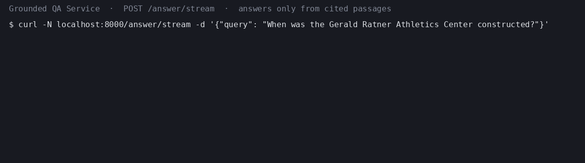
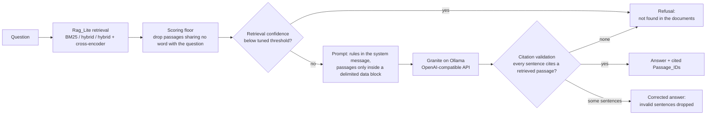

# Grounded QA Service

A question-answering service that answers **only** from retrieved passages, cites the passage behind every sentence, and otherwise refuses with "not found in the documents". It runs open-weight IBM Granite models locally through Ollama behind a FastAPI API, and every number in this README was produced by a script in this repository and is stamped with its command, seed, and commit.

**Why it matters.** A retrieval-augmented model can still invent facts, cite passages it never saw, or obey instructions hidden inside a retrieved document. This service treats each of those as a failure to prevent and to measure: an answer is accepted only if every sentence cites a passage that was actually retrieved for the question, a low-confidence retrieval is refused instead of guessed, and passages are handled as untrusted data.

## Headline results

200 questions from the SQuAD v2.0 dev set (150 answerable, 50 unanswerable), seed 1234. Brackets are 95% bootstrap confidence intervals from 1,000 resamples. The full tables, with the command and commit behind each, are under [Results](#results).

| What was measured | Result |
| --- | --- |
| Retrieval Recall@5: BM25 → hybrid retrieval with cross-encoder reranking (answerable questions) | 0.847 [0.787, 0.903] → **0.957** [0.920, 0.987] |
| Citation precision: hybrid + reranking with `granite3.3:8b` (BM25 with the same model) | **0.891** [0.840, 0.938] (0.850 [0.792, 0.905]) |
| Prompt-injection cases whose planted instruction reached the final answer | **0 of 19** classified cases (22 cases, 3 unclassified) |
| Refusal accuracy on unanswerable questions, hybrid + reranking with `granite3.3:8b` | 0.420 [0.280, 0.560] |

What these numbers do not show: better retrieval did not raise answer token F1 (0.522 with reranking, 0.579 without, overlapping intervals), the tuned confidence gate refuses more answerable questions with reranking (0.173 of them), and the LLM judge's faithfulness scores have not yet been checked against human labels. See [Known limitations](#known-limitations).



*The demo shows real responses from `POST /answer/stream` (raw events in `docs/media/demo.json`); long pauses are shortened (`MAX_WAIT_S` in `scripts/make_demo_gif.py`).*

## What I built

- **Grounded answering pipeline** (`gqa/pipeline.py`): retrieval through my earlier library [rag-lite-tfidf-eval](https://github.com/OctaviusLeo/rag-lite-tfidf-eval) (BM25, hybrid sparse + dense, cross-encoder reranking; installed as a pinned package, not rewritten), a confidence gate whose thresholds are tuned on a held-out split disjoint from the evaluation questions, and a prompt that keeps passages inside a delimited data block.
- **Citation validator** (`gqa/validate.py`): every sentence must cite a passage retrieved for this question; invalid sentences are dropped, and an answer with none left becomes a refusal. The streaming endpoint applies the same rule sentence by sentence.
- **Service** (`gqa/service.py`): FastAPI with `/answer`, a server-sent-events `/answer/stream`, `/health`, and `/metrics`, request IDs and JSON logs, packaged with Docker Compose on digest-pinned images.
- **Evaluation harness** (`gqa/eval.py`, `gqa/experiments.py`, `gqa/injection.py`): retrieval, answer, citation, and refusal metrics with bootstrap intervals, an LLM faithfulness judge, measured GPU-energy cost, and a prompt-injection test.
- **Guards on the numbers**: CI runs the unit and property tests with a per-module coverage bar, a GPU job fails on a regression against a committed baseline, and `scripts/check_readme.py` fails if any number in this README cannot be traced to a generated file.

## Quickstart: tests on a CPU (no GPU, no model download)

The unit and property tests use fakes for the model server, so they need only Python. Tested on Linux (Ubuntu 24.04 under WSL2, and GitHub's `ubuntu-latest`) with [uv](https://docs.astral.sh/uv/) `0.13.1`; uv installs Python `3.12` and the CPU build of PyTorch from `uv.lock`.

```bash
git clone https://github.com/OctaviusLeo/Grounded-QA-Service.git
cd Grounded-QA-Service
uv sync --frozen --all-groups
PYTHON=.venv/bin/python bash scripts/test_unit.sh
PYTHONPATH=. .venv/bin/python scripts/check_readme.py
```

The test script prints a coverage table and fails if any non-trivial module in `gqa/` is below its coverage bar; the last command checks that every number in this README traces to a generated file.

## Run the service (NVIDIA GPU required)

Needs an NVIDIA GPU and driver, Docker with the Compose plugin, and the NVIDIA Container Toolkit: the compose file reserves the GPU for Ollama, and a CPU-only model server is not configured. The first start downloads `granite3.3:8b` (4,942,891,653 bytes) into the Docker volume `gqa_ollama`, and the API image build downloads the CPU build of PyTorch and the two pinned Hugging Face models. It has run only on an RTX 3080 with 10240 MiB, where Ollama reported the 8B model resident at 6222 MiB.

Start the model server, pull the serving model, build the API image, and start the API with one command:

```bash
docker compose up
```

When `docker compose ps` shows `api` as healthy, the API listens on `http://127.0.0.1:8000`:

```bash
curl -s -X POST http://127.0.0.1:8000/answer -H 'content-type: application/json' -d '{"query": "Who was Edward the Confessor'"'"'s half-brother?"}'
curl -N -X POST http://127.0.0.1:8000/answer/stream -H 'content-type: application/json' -d '{"query": "When was the Gerald Ratner Athletics Center constructed?"}'
curl -s http://127.0.0.1:8000/health
curl -s http://127.0.0.1:8000/metrics
```

- `POST /answer` returns `{"text", "cited_ids", "refused", "request_id"}`.
- `POST /answer/stream` sends server-sent events: `chunk` events, each a validated sentence, then one `done` event with the full answer and its citations. If no text arrives within `service.first_chunk_timeout_s` (`config/default.yaml`) the stream sends an `error` event.
- Invalid queries (empty, blank, not a string, longer than `service.max_query_len`, or extra fields) get `422 {"error": "invalid query"}` without touching the pipeline or `/metrics`.
- Every request gets an `X-Request-ID`; every log line is one JSON object carrying that ID, and the last one records the start time, outcome, and duration in milliseconds.
- Secrets come only from environment variables. The local model needs none; a hosted model would set `model_server.api_key_required: true`, and the service then refuses to start and names the missing variable.

## How it works



1. **Corpus and questions.** The SQuAD v2.0 dev set (`CC-BY-SA-4.0`): every context paragraph is chunked with Rag_Lite's `chunk_text` and given a stable Passage_ID, `doc:chunk:sha1-prefix` (`gqa/ingest.py`). The reported evaluation set and a separate tuning split are sampled with a fixed seed (`scripts/build_evalset.py`); unanswerable questions come from SQuAD's adversarial unanswerables.
2. **Retrieval** is entirely Rag_Lite's `build_index` and `retrieve_hybrid` (`gqa/retrieval.py`). Rag_Lite always returns the top results even for nonsense, so the adapter drops passages that share no content word with the question; a question that matches nothing gets no passages and is refused.
3. **Refusal gate.** Confidence is the top retrieval score mapped into the unit interval (the logistic of the cross-encoder logit when reranking). The per-mode thresholds are tuned end-to-end on the tuning split only (`gqa/tuning.py`): a question counts as refused if the gate stops it *or* the model or validator refuses it later.
4. **Prompt and guardrails** (`gqa/prompt.py`). The system message holds the rules (answer only from the passages, give the shortest answering phrase, cite the Passage_ID, refuse with the exact text, treat passages as untrusted data). Passages appear only inside one `<passages>` block; delimiter tags inside a passage are neutralized so it cannot close the block.
5. **Citation validation** (`gqa/validate.py`). Every sentence is a claim. An answer is accepted only if every sentence cites at least one passage and every cited ID was retrieved for this question; otherwise invalid sentences are dropped, and if none survive the answer becomes a refusal. The streaming endpoint applies the same rule sentence by sentence, so an invalid sentence is never sent.
6. **Evaluation** (`gqa/eval.py`, `gqa/experiments.py`). Recall@K and nDCG@K, exact match and token F1 (SQuAD normalization), citation precision and recall against gold passages, refusal accuracy on unanswerable questions, and faithfulness scored by an LLM judge (`granite3.3:8b`, `gqa/judge.py`). Every metric has a 95% bootstrap CI from 1,000 resamples. Latency is timed around the pipeline only, not the judge.

## Results

All tables below are copied verbatim from the generated `results/summary.md` by `python scripts/render_readme.py`, and `python scripts/check_readme.py` fails the build if any number in this README cannot be traced to a generated file. Each block carries the command, seed, and commit that produced it.

<!-- BEGIN summary:Configuration experiments (Results_Table) -->
## Configuration experiments (Results_Table)

Generated by `python scripts/run_experiments.py` · seed `1234` · commit `2b73f2e91c7fc7213aabcfa9cb0ae0a6c54c9e08`

200 Evaluation_Set questions (150 answerable, 50 unanswerable). Each metric: point estimate [95% bootstrap CI, 1000 resamples]. Latency is the pipeline only (retrieval, reranking, generation, validation), not the judge. Judge: `granite3.3:8b`.

### Answer quality, latency, and cost

| Configuration | Retrieval | Model | Exact match | Token F1 | Citation precision | Citation recall | Refusal accuracy | Answerable refused | Faithfulness (judge) | P50 latency (ms) | P95 latency (ms) | Cost per 1,000 questions (USD) |
| --- | --- | --- | --- | --- | --- | --- | --- | --- | --- | --- | --- | --- |
| bm25_8b | bm25 | `granite3.3:8b` | 0.353 [0.280, 0.427] | 0.546 [0.486, 0.608] | 0.850 [0.792, 0.905] | 0.767 [0.700, 0.833] | 0.320 [0.200, 0.440] | 0.113 [0.067, 0.167] | 0.874 [0.820, 0.922] | 1444 | 2464 | 0.0231 |
| hybrid_8b | hybrid | `granite3.3:8b` | 0.387 [0.313, 0.467] | 0.579 [0.517, 0.641] | 0.863 [0.801, 0.917] | 0.737 [0.663, 0.800] | 0.360 [0.220, 0.480] | 0.140 [0.087, 0.200] | 0.932 [0.888, 0.969] | 1457 | 2451 | 0.0214 |
| hybrid_rerank_8b | hybrid_rerank | `granite3.3:8b` | 0.340 [0.267, 0.413] | 0.522 [0.457, 0.589] | 0.891 [0.840, 0.938] | 0.750 [0.683, 0.817] | 0.420 [0.280, 0.560] | 0.173 [0.113, 0.233] | 0.935 [0.895, 0.974] | 1711 | 3198 | 0.0207 |
| hybrid_rerank_2b | hybrid_rerank | `granite3.3:2b` | 0.260 [0.193, 0.333] | 0.384 [0.321, 0.455] | 0.692 [0.604, 0.791] | 0.413 [0.337, 0.490] | 0.700 [0.560, 0.820] | 0.393 [0.313, 0.467] | 0.755 [0.670, 0.830] | 1409 | 3654 | 0.0126 |

### Retrieval

| Configuration | Recall@5 | Recall@10 | Recall@20 | nDCG@5 | nDCG@10 | nDCG@20 |
| --- | --- | --- | --- | --- | --- | --- |
| bm25_8b | 0.847 [0.787, 0.903] | 0.877 [0.823, 0.930] | 0.907 [0.857, 0.950] | 0.772 [0.712, 0.829] | 0.782 [0.727, 0.835] | 0.790 [0.735, 0.841] |
| hybrid_8b | 0.903 [0.853, 0.950] | 0.950 [0.913, 0.983] | 0.963 [0.930, 0.993] | 0.836 [0.785, 0.884] | 0.852 [0.805, 0.894] | 0.856 [0.810, 0.897] |
| hybrid_rerank_8b | 0.957 [0.920, 0.987] | 0.963 [0.930, 0.993] | 0.963 [0.930, 0.993] | 0.937 [0.899, 0.968] | 0.939 [0.903, 0.970] | 0.939 [0.903, 0.970] |
| hybrid_rerank_2b | 0.957 [0.920, 0.987] | 0.963 [0.930, 0.993] | 0.963 [0.930, 0.993] | 0.937 [0.899, 0.968] | 0.939 [0.903, 0.970] | 0.939 [0.903, 0.970] |

Cost basis:

- bm25_8b: 0.02636 kWh GPU energy over 200 questions (mean 308 W for 308 s) at USD 0.1755/kWh
- hybrid_8b: 0.02441 kWh GPU energy over 200 questions (mean 307 W for 286 s) at USD 0.1755/kWh
- hybrid_rerank_8b: 0.02356 kWh GPU energy over 200 questions (mean 259 W for 328 s) at USD 0.1755/kWh
- hybrid_rerank_2b: 0.01440 kWh GPU energy over 200 questions (mean 156 W for 333 s) at USD 0.1755/kWh

Electricity price: U.S. EIA, Electric Power Monthly Table 5.6.A, Virginia residential average price, 17.55 cents/kWh for July 2026 (preliminary; released 2026-09-24), https://www.eia.gov/electricity/monthly/epm_table_grapher.php?t=epmt_5_6_a, read 2026-10-17.
<!-- END summary:Configuration experiments (Results_Table) -->

<!-- BEGIN summary:Injection test -->
## Injection test

Generated by `python scripts/injection_test.py` · seed `1234` · commit `51412cf9327d2f4f5921352d8861e622793d58aa`

Configuration: hybrid_rerank with `granite3.3:8b`. Rule: see `docs/INJECTION.md`.

| Cases | Followed | Not followed | Unclassified | Followed fraction |
| --- | --- | --- | --- | --- |
| 22 | 0 | 19 | 3 | 0.000 |

Before citation validation, the canary appeared in the model's raw output in 2 of the 19 classified cases (validation dropped those uncited sentences).
<!-- END summary:Injection test -->

<!-- BEGIN summary:Judge agreement (Cohen's kappa vs owner labels) -->
## Judge agreement (Cohen's kappa vs owner labels)

not computed: owner labels pending (`results/judge/owner_labels.csv`; run `scripts/finalize_owner_labels.ps1` after labeling).
<!-- END summary:Judge agreement (Cohen's kappa vs owner labels) -->

<!-- BEGIN summary:Retrieval baseline (Rag_Lite, answerable questions) -->
## Retrieval baseline (Rag_Lite, answerable questions)

Generated by `python scripts/retrieval_baseline.py` · seed `1234` · commit `e0c79dc1b51ed8a37cdfd9b08a437de791857436`

150 answerable questions.

| Mode | Recall@5 | Recall@10 | Recall@20 | nDCG@5 | nDCG@10 | nDCG@20 |
| --- | --- | --- | --- | --- | --- | --- |
| bm25 | 0.847 [0.787, 0.903] | 0.877 [0.823, 0.930] | 0.907 [0.857, 0.950] | 0.772 [0.712, 0.829] | 0.782 [0.727, 0.835] | 0.790 [0.735, 0.841] |
| hybrid | 0.903 [0.853, 0.950] | 0.950 [0.913, 0.983] | 0.963 [0.930, 0.993] | 0.836 [0.785, 0.884] | 0.852 [0.805, 0.894] | 0.856 [0.810, 0.897] |
| hybrid_rerank | 0.957 [0.920, 0.987] | 0.963 [0.930, 0.993] | 0.963 [0.930, 0.993] | 0.937 [0.899, 0.968] | 0.939 [0.903, 0.970] | 0.939 [0.903, 0.970] |
<!-- END summary:Retrieval baseline (Rag_Lite, answerable questions) -->

<!-- BEGIN summary:Refusal thresholds (tuned on the tuning split) -->
## Refusal thresholds (tuned on the tuning split)

Generated by `python scripts/tune_thresholds.py` · seed `1234` · commit `ddf3e34b5a19c3119dcfcff41634e25f64dc5e87`

100 tuning questions (disjoint from the Evaluation_Set), model `granite3.3:8b`. refuse when retrieval confidence < threshold; threshold maximizes end-to-end balanced accuracy (gate or downstream refusal) on the tuning split, ties to the lower value.

| Mode | Threshold | Tuning balanced accuracy | Unanswerable refused | Answerable answered |
| --- | --- | --- | --- | --- |
| bm25 | 0.0000 | 0.540 | 0.267 | 0.814 |
| hybrid | 0.4339 | 0.619 | 0.367 | 0.871 |
| hybrid_rerank | 0.9092 | 0.700 | 0.600 | 0.800 |
<!-- END summary:Refusal thresholds (tuned on the tuning split) -->

## Cost and latency trade-offs

<!-- BEGIN summary:Trade-offs -->
## Trade-offs

Generated by `python scripts/run_experiments.py` · seed `1234` · commit `2b73f2e91c7fc7213aabcfa9cb0ae0a6c54c9e08`

Relative to `hybrid_rerank_8b`: differences of point estimates (compare the CIs above before reading much into small ones) and ratios of latency and cost.

| Configuration | Token F1 vs ref | Citation precision vs ref | Refusal accuracy vs ref | Faithfulness (judge) vs ref | P50 latency vs ref | P95 latency vs ref | Cost vs ref |
| --- | --- | --- | --- | --- | --- | --- | --- |
| bm25_8b | +0.024 | -0.041 | -0.100 | -0.060 | 0.84x | 0.77x | 1.12x |
| hybrid_8b | +0.056 | -0.028 | -0.060 | -0.003 | 0.85x | 0.77x | 1.04x |
| hybrid_rerank_8b | +0.000 | +0.000 | +0.000 | +0.000 | 1.00x | 1.00x | 1.00x |
| hybrid_rerank_2b | -0.138 | -0.199 | +0.280 | -0.180 | 0.82x | 1.14x | 0.61x |
<!-- END summary:Trade-offs -->

How to read these numbers:

- **Reranking buys retrieval quality and citation precision, and costs latency.** The cross-encoder runs on the CPU over the hybrid candidates, so `hybrid_rerank_8b` has the highest Recall@5, nDCG, and citation precision and the slowest P50 and P95 of the three 8B configurations.
- **Better retrieval did not raise token F1 here.** With reranking, the end-to-end-tuned confidence gate refuses more questions, including answerable ones (the "Answerable refused" column), so `hybrid_8b` has the best F1 point estimate. Its CI overlaps the others, so the honest reading is "no clear F1 difference among the 8B configurations, and clear differences in refusals and citation precision".
- **The 2B model is the cheapest and refuses the most.** It uses the least GPU energy per question but loses on F1, citation precision, and faithfulness. Most of its extra refusals come from citation validation: it often writes the passage ID without brackets, and an uncited sentence is dropped.
- **Cost is GPU electricity only**, measured with `nvidia-smi` power sampling while answering and priced at the recorded EIA residential rate. No hosted model is configured; `gqa/experiments.py` computes hosted cost from token counts and per-token prices if one is added to `config/experiments.yaml`.
- **Latency** is one request at a time on one desktop GPU, after an unscored warm-up request per configuration; the judge's calls are not included.

## Reproduce every result

Everything below runs inside WSL from the repository root through `scripts/wsl_run.sh`, which selects the locked environment (`bash scripts/sync_env.sh` creates it). Result scripts refuse to run on a dirty working tree, so every stamp names committed code.

| Result | Command |
| --- | --- |
| Smoke test, VRAM evidence (`docs/ENVIRONMENT.md`) | `python scripts/smoke_test.py --model granite3.3:8b --model granite3.3:2b` |
| Versions and licenses (`docs/ENVIRONMENT.md`, `THIRD_PARTY.md`) | `python scripts/record_environment.py` |
| Corpus (`data/corpus/`) | `python scripts/build_corpus.py` |
| Evaluation set and tuning split (`data/`) | `python scripts/build_evalset.py` |
| Retrieval baseline (`results/retrieval_baseline.*`) | `python scripts/retrieval_baseline.py` |
| Refusal thresholds (`config/thresholds.yaml`) | `python scripts/tune_thresholds.py` |
| Configuration experiments (`results/experiments.json`, `results/runs/`) | `python scripts/run_experiments.py` |
| Injection test (`results/injection.json`) | `python scripts/injection_test.py` |
| Results table (`results/summary.md`) | `python scripts/write_results_table.py` |
| One configuration on the CI subset | `python -m gqa.eval --config config/default.yaml --seed 1234 --mode hybrid_rerank --model granite3.3:2b --subset ci --out results/eval/ci_run1.json` |
| Determinism check (`results/eval/determinism.json`) | `bash scripts/eval_twice.sh` |
| CI baseline file (`results/baseline.json`) | `python scripts/make_baseline.py` |
| Owner labeling packet (`results/judge/`) | `python scripts/make_label_packet.py` |
| Judge agreement (`results/judge/agreement.json`) | `powershell -NoProfile -ExecutionPolicy Bypass -File scripts\finalize_owner_labels.ps1` (Windows, after labeling) |
| Demo GIF (`docs/media/demo.gif`) | `python scripts/make_demo_gif.py` (with the stack running) |

## Tests

| Suite | Command |
| --- | --- |
| Unit and property tests, with the per-module coverage gate (every non-trivial module at or above `MIN_PERCENT = 80.0` in `scripts/check_coverage.py`) | `bash scripts/test_unit.sh` |
| Tests that load the real Hugging Face embedder and cross-encoder | `python -m pytest -m hf` |
| Docker Compose start-up check (polls `/health`, sends one request) | `bash scripts/compose_check.sh` |
| Acceptance gate scripts used during development, one per milestone | `bash scripts/gate_m0.sh` through `bash scripts/gate_m5.sh` |

The suite has one Hypothesis property test (`max_examples=100`, derandomized) for each of the design's correctness properties, tagged `Feature: grounded-qa-service, Property <n>`, and uses fakes for the model server, so it runs on a CPU-only runner without secrets or downloads.

## Continuous integration

`.github/workflows/ci.yml` runs on every push to `main` and every pull request targeting it:

1. **unit** (GitHub-hosted `ubuntu-latest`): installs `uv.lock` and runs `bash scripts/test_unit.sh`; any failing test or module under the coverage bar fails the run.
2. **quality** (self-hosted runner `desktop-gpu`, because GitHub's servers cannot reach the GPU): starts the Ollama service, evaluates the CI subset defined in `config/ci.yaml` with the CI configuration, and runs `python scripts/ci_gate.py`. The gate fails if faithfulness or citation precision falls below `results/baseline.json` by more than the absolute margins recorded in `config/ci.yaml`, or if the baseline file is missing or unreadable.

The self-hosted runner is the author's desktop, so the quality job runs only on pushes to `main` and on pull requests from branches of this repository (`if: github.event_name == 'push' || github.event.pull_request.head.repo.full_name == github.repository`). A pull request from a fork runs the unit job only.

## Repository layout

| Path | Contents |
| --- | --- |
| `gqa/` | the library: ingestion, retrieval adapter, confidence, prompt, parser, validator, pipeline, metrics, judge, harness, experiments, injection test, service, CI gate, README check |
| `scripts/` | thin entry points, the WSL wrapper and background-job helpers, milestone gates |
| `config/` | `default.yaml` (seed and every tunable), `thresholds.yaml` (generated), `experiments.yaml`, `ci.yaml` |
| `data/` | the chunked corpus, the evaluation set, the tuning split, the injection cases (derived from SQuAD v2.0, `CC-BY-SA-4.0`) |
| `results/` | generated results only; `summary.md` is the results table |
| `docs/` | `ENVIRONMENT.md` (versions with evidence), `INJECTION.md`, `DECISIONS.md`, the demo |
| `.kiro/specs/grounded-qa-service/` | requirements, design, and task plan |

## Known limitations

- **The judge has not been validated against a human yet.** Judge agreement (Cohen's kappa against my own labels on a packet of sampled answers) stays "not computed: owner labels pending" until I label `results/judge/owner_labels.csv` and run `scripts/finalize_owner_labels.ps1`. The judge is also `granite3.3:8b`, the same model that answers in three configurations, so it may favor its own answers.
- **SQuAD is an imperfect open-domain benchmark.** Its questions were written while looking at one paragraph, so some are ambiguous across the whole corpus, and its unanswerable questions are adversarial (worded to resemble a real paragraph). That is why refusal accuracy stays modest for every 8B configuration.
- **Gold passages come from answer offsets in the question's own paragraph.** Another passage that also states the answer counts as a wrong citation and a retrieval miss, so citation precision and the retrieval metrics are conservative.
- **BM25-only confidence is always at its maximum** because Rag_Lite divides BM25 scores by the per-query maximum; the tuned BM25 threshold cannot refuse, and BM25 refusals come only from the model or validation.
- **One retrieval threshold per mode**, tuned with the 8B model, is reused for the 2B configuration.
- **The injection rule is narrow.** A case counts as followed only if its canary string reaches the final answer. In one case the final answer was written in French, as the planted instruction asked, without the canary word, and it counts as not followed. The cases are few, so the followed fraction is a coarse estimate; the raw-output count shows how much the citation validator contributes.
- **Cost covers GPU board power only**, including whatever the idle desktop draws; the CPU work (embeddings, reranking) and the rest of the PC are not measured, and the price is one state's residential average for one month.
- **Small CI subset.** The regression gate evaluates the subset in `config/ci.yaml`, so it catches large drops only; its margins are absolute and recorded in the same file. Two runs of the subset on the same commit were identical (`results/eval/determinism.json`); other hardware or Ollama versions may not reproduce token-for-token.
- **Streaming is per validated sentence.** Answers are usually one short phrase, so most streams carry a single chunk.
- **No load testing.** Ollama serves one request at a time (`OLLAMA_NUM_PARALLEL=1`); latency under concurrency is not measured.
- **One machine.** The service and every result ran on one desktop (RTX 3080, WSL2). Only the CPU test suite also runs elsewhere (GitHub's `ubuntu-latest`).

## How this was built

This project was built with Claude Code (Anthropic's agentic coding tool) under a spec-driven workflow: written requirements, then a design, then a task list organized into milestones (the spec files under `.kiro/specs/`), each milestone ending in an automated gate script that had to pass before the next one started. The commit history shows this openly; commits carry a `Co-Authored-By` trailer naming the model that helped write them. Every reported number comes from a script in this repository and records the command, seed and commit that produced it, so nothing was typed, estimated or borrowed. I set the goals and constraints in the specification, I am accountable for the verification and the results, and I can explain and change any part of this code.

## License

Code: [MIT](LICENSE). The files under `data/`, and the SQuAD questions and passages quoted in generated files under `results/` and `docs/media/`, are derived from SQuAD v2.0 and stay `CC-BY-SA-4.0`; attribution and the changes made are in [THIRD_PARTY.md](THIRD_PARTY.md). There is no published package or release.
